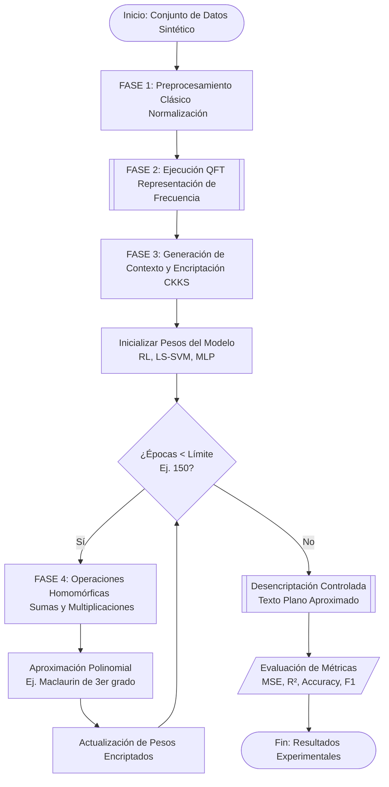
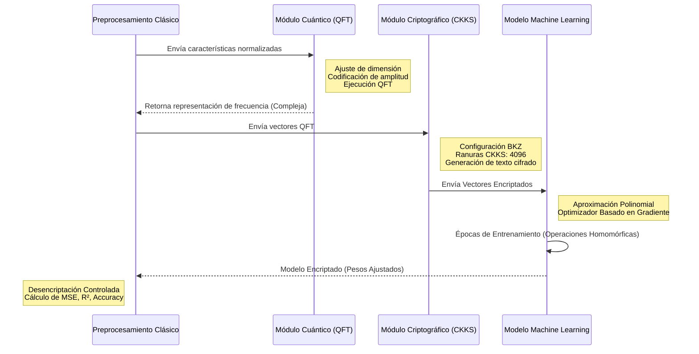

# Modelo de Arquitectura Cuántica-Clásica con Encriptación Homomórfica para Entrenamiento y Preservación de la Privacidad en el Aprendizaje Automático

Este repositorio contiene la implementación experimental del proyecto de investigación:
**"Modelo de Arquitectura Cuántica-Clásica con Encriptación Homomórfica para Entrenamiento y Preservación de la Privacidad en el Aprendizaje Automático".**

La arquitectura propuesta integra la **Transformada Cuántica de Fourier (QFT)** con el **esquema de encriptación homomórfica CKKS** para investigar el aprendizaje automático que preserva la privacidad sobre representaciones en el dominio de la frecuencia.

El flujo de trabajo experimental combina el preprocesamiento clásico, la transformación de características cuánticas, la encriptación homomórfica, el aprendizaje automático y la evaluación cuantitativa.

## 📌 Tabla de Contenidos
- [Descripción General](#-descripción-general)
- [Objetivo de la Investigación](#-objetivo-de-la-investigación)
- [Arquitectura del Sistema](#-arquitectura-del-sistema)
- [Fundamentos Matemáticos](#-fundamentos-matemáticos)
- [Canalización y Procesamiento de Datos](#-canalización-y-procesamiento-de-datos)
- [Transformada Cuántica de Fourier](#️-transformada-cuántica-de-fourier)
- [Canal de Encriptación Homomórfica](#-canal-de-encriptación-homomórfica)
- [Modelos de Aprendizaje Automático](#-modelos-de-aprendizaje-automático)
- [Configuración Experimental](#-configuración-experimental)
- [Métricas de Evaluación](#-métricas-de-evaluación)
- [Resultados Experimentales](#-resultados-experimentales)
- [Estructura del Repositorio](#-estructura-del-repositorio)
- [Instalación](#-instalación)
- [Flujo de Ejecución](#️-flujo-de-ejecución)
- [Hardware y Entorno](#-hardware-y-entorno)
- [Reproducibilidad](#-reproducibilidad)
- [Consideraciones de Seguridad](#-consideraciones-de-seguridad)
- [Limitaciones](#limitaciones)
- [Citación](#citación)
- [Autor](#autor)
- [Licencia](#licencia)

---

## 🔬 Descripción General

La arquitectura propuesta investiga un canal computacional híbrido en el cual los datos clásicos se transforman a una representación en el dominio de la frecuencia utilizando la Transformada Cuántica de Fourier (QFT) y, posteriormente, se protegen mediante la encriptación homomórfica CKKS.

El flujo de trabajo general es:

```text
Datos Clásicos
      │
      ▼
Generación de Conjunto de Datos Sintético
      │
      ▼
Preprocesamiento de Datos
      │
      ▼
Normalización
      │
      ▼
Codificación de Amplitud
      │
      ▼
Transformada Cuántica de Fourier (QFT)
      │
      ▼
Representación en el Dominio de la Frecuencia
      │
      ▼
Encriptación Homomórfica CKKS
      │
      ▼
Aprendizaje Automático
      │
      ├── Regresión Lineal
      ├── Regresión Logística
      ├── LS-SVM
      └── MLP
      │
      ▼
Evaluación
      │
      ├── MSE
      ├── RMSE
      ├── MAE
      ├── R²
      └── Precisión (Accuracy)
```

El propósito no es afirmar que la computación cuántica reemplaza al aprendizaje automático clásico, sino estudiar experimentalmente la integración de:

- Transformación de características cuánticas.
- Encriptación homomórfica.
- Aprendizaje automático.
- Preservación de la privacidad.
- Escalabilidad computacional.

### 🎯 Objetivo de la Investigación

El objetivo principal es desarrollar y evaluar experimentalmente una arquitectura cuántica-clásica con encriptación homomórfica para aplicaciones de aprendizaje automático donde la privacidad de los datos es un requisito importante.

La arquitectura evalúa la interacción entre:

```plaintext
Transformada Cuántica de Fourier
              +
Encriptación Homomórfica
              +
Aprendizaje Automático
              +
Preservación de la Privacidad
```

### 🏗️ Arquitectura del Sistema

La arquitectura propuesta consta de cuatro fases principales.

```plaintext
┌──────────────────────────────────────────────────┐
│                     FASE 1                       │
│         PROCESAMIENTO DE DATOS CLÁSICOS          │
│                                                  │
│ Datos Sintéticos → Normalización → Codificación  │
└───────────────────────┬──────────────────────────┘
                        │
                        ▼
┌──────────────────────────────────────────────────┐
│                     FASE 2                       │
│             TRANSFORMACIÓN CUÁNTICA              │
│                                                  │
│           Codificación de Amplitud → QFT         │
└───────────────────────┬──────────────────────────┘
                        │
                        ▼
┌──────────────────────────────────────────────────┐
│                     FASE 3                       │
│             PROTECCIÓN HOMOMÓRFICA               │
│                                                  │
│       Representación de Frecuencia → CKKS        │
└───────────────────────┬──────────────────────────┘
                        │
                        ▼
┌──────────────────────────────────────────────────┐
│                     FASE 4                       │
│             APRENDIZAJE AUTOMÁTICO               │
│                                                  │
│     RL → Regresión Logística → LS-SVM → MLP      │
└──────────────────────────────────────────────────┘
```

### 📐 Fundamentos Matemáticos

#### 1. Codificación de Amplitud

Sea:

$$x=[x_0,x_1,\ldots,x_{N-1}]$$

un vector clásico normalizado. El vector puede representarse como un estado cuántico:

$$\vert{}x\rangle = \sum_{k=0}^{N-1}x_k\vert{}k\rangle$$

sujeto a:

$$\sum_{k=0}^{N-1}\vert{}x_k\vert{}^2=1$$

La codificación de amplitud permite que un vector clásico sea representado a través de las amplitudes de un estado cuántico.

#### 2. Transformada Cuántica de Fourier

La Transformada Cuántica de Fourier se define como:

$$QFT\vert{}k\rangle = \frac{1}{\sqrt{N}} \sum_{j=0}^{N-1} e^{2\pi i kj/N}\vert{}j\rangle$$

Para un estado general:

$$\vert{}x\rangle = \sum_{k=0}^{N-1}x_k\vert{}k\rangle$$

el estado transformado resulta en:

$$QFT\vert{}x\rangle = \frac{1}{\sqrt{N}} \sum_{j=0}^{N-1} \left( \sum_{k=0}^{N-1} x_k e^{2\pi i kj/N} \right) \vert{}j\rangle$$

Las amplitudes resultantes contienen información sobre la representación en el dominio de la frecuencia de la entrada.


#### 3. Encriptación Homomórfica

La arquitectura utiliza CKKS (Cheon-Kim-Kim-Song) para aritmética aproximada sobre datos numéricos encriptados. CKKS se basa en construcciones criptográficas basadas en retículos (lattices) relacionadas con el problema de Aprendizaje con Errores en Anillos (RLWE).

La cadena de procesamiento conceptual es:

```plaintext
  Texto Plano (Plaintext)
             │
             ▼
     Codificación CKKS
             │
             ▼
       Encriptación
             │
             ▼
 Texto Cifrado (Ciphertext)
             │
             ▼
  Operaciones Homomórficas
             │
             ▼
      Desencriptación
             │
             ▼
   Texto Plano Aproximado
```

### 📊 Canalización y Procesamiento de Datos

El flujo experimental comienza con conjuntos de datos sintéticos que representan datos de consumo de energía. Las variables principales son:

| Variable | Descripción |
| :--- | :--- |
| `temp_ambiente` | Temperatura ambiente |
| `num_personas` | Número de personas |
| `eficiencia_maquina` | Eficiencia de la máquina |
| `consumo_kwh` | Objetivo de consumo de energía |

Los experimentos consideran:

- 1,000 registros
- 10,000 registros
- 100,000 registros
- 500,000 registros
- 1,000,000 registros

#### 1. Generación de Datos Sintéticos
##### El Algoritmo (TVAE Synthetic Data Generation)

**Algoritmo: Massive Synthetic Data Generation via TVAE and Batch Processing for CKKS Homomorphic Encryption**
<hr>

$$
\begin{array}{rl}
& \text{Input: Real tabular dataset } D_{\text{real}}\text{, Total target synthetic rows } N\text{, Batch size } B\text{,} \\
& \quad \text{Training epochs } E\text{, Output filename } F_{\text{out}} \\
& \text{Output: Exported CSV dataset } F_{\text{out}} \text{ optimized for CKKSEncoder} \\
1 & M \leftarrow \text{SingleTableMetadata}() \\
2 & M.\text{detect\\_from\\_dataframe}(D_{\text{real}}) \\
3 & \mathcal{M} \leftarrow \text{TVAESynthesizer}(M, \text{enforce\\_min\\_max\\_values}=\text{True}, \text{epochs}=E) \\
4 & \mathcal{M}.\text{fit}(D_{\text{real}}) \hspace{4.8cm} \text{// Train TVAE on latent feature distributions} \\
5 & Chunks \leftarrow [\,] \\
6 & N_{\text{generated}} \leftarrow 0 \\
7 & \textbf{while } N_{\text{generated}} < N \textbf{ do} \\
8 & \quad b_{\text{current}} \leftarrow \min(B, N - N_{\text{generated}}) \hspace{1.6cm} \text{// Dynamic batch boundary calculation} \\
9 & \quad C_k \leftarrow \mathcal{M}.\text{sample}(\text{num\\_rows}=b_{\text{current}}) \hspace{0.9cm} \text{// Sample vectors from TVAE latent space} \\
10 & \quad \text{Append } C_k \text{ to } Chunks \\
11 & \quad N_{\text{generated}} \leftarrow N_{\text{generated}} + b_{\text{current}} \\
12 & D_{\text{synth}} \leftarrow \text{Concat}(Chunks, \text{ignore\\_index}=\text{True}) \\
13 & \textbf{if } \text{HasNullValues}(D_{\text{synth}}) \textbf{ then} \\
14 & \quad D_{\text{synth}} \leftarrow \text{ImputeWithColumnMean}(D_{\text{synth}}) \hspace{0.5cm} \text{// Prevent CKKS encoding faults} \\
15 & \text{ExportToCSV}(D_{\text{synth}}, \text{path}=F_{\text{out}}, \text{float\\_format}=\text{'\%.10f'}) \hspace{0.2cm} \text{// Maintain 10-decimal float accuracy} \\
16 & \textbf{return } F_{\text{out}}
\end{array}
$$

<hr>

La primera etapa genera los conjuntos de datos experimentales. Ejemplo:

- `dataset_sintetico_1k.csv`
- `dataset_sintetico_10k.csv`
- `dataset_sintetico_100k.csv`
- `dataset_sintetico_500k.csv`
- `dataset_sintetico_1m.csv`

Los datos generados son posteriormente normalizados antes del procesamiento cuántico.

<details>
<summary><b>💻 Haz clic aquí para desplegar el Código Fuente (Python)</b></summary>

```python
import pandas as pd
import numpy as np
import os
import warnings

# =============================================================================
# PASO 1: CONFIGURACIÓN DEL ENTORNO Y LIBRERÍAS
# =============================================================================
# Forzamos el uso de la CPU para evitar errores de falta de memoria (OOM) 
# al generar grandes volúmenes de datos sintéticos con la GPU.
os.environ["CUDA_VISIBLE_DEVICES"] = "" 
warnings.filterwarnings('ignore')

from sdv.metadata import SingleTableMetadata
from sdv.single_table import TVAESynthesizer
from sdv.evaluation.single_table import evaluate_quality
from sklearn.linear_model import LinearRegression
from sklearn.metrics import r2_score

# =============================================================================
# PASO 2: GENERACIÓN DE DATOS SEMILLA (GROUND TRUTH)
# =============================================================================
# Fijamos la semilla aleatoria para asegurar la reproducibilidad del experimento.
np.random.seed(42)
n_rows_seed = 1000

# Creamos las variables independientes (Matriz X) con diferentes distribuciones
data = pd.DataFrame({
    'temp_ambiente': np.random.normal(25, 5, n_rows_seed),
    'num_personas': np.random.poisson(10, n_rows_seed).astype(float),
    'eficiencia_maquina': np.random.uniform(0.5, 0.95, n_rows_seed),
})

# Definimos la relación lineal exacta (Variable objetivo Y) introduciendo ruido blanco
# Ecuación: y = 10 + 2.5*x1 + 4.0*x2 - 12.0*x3 + ruido
data['consumo_kwh'] = (
    10 + 
    (2.5 * data['temp_ambiente']) + 
    (4.0 * data['num_personas']) - 
    (12.0 * data['eficiencia_maquina']) + 
    np.random.normal(0, 1, n_rows_seed)
)

print(f"[INFO] Datos semilla generados: {data.shape[0]} registros.")

# =============================================================================
# PASO 3: EXTRACCIÓN DE METADATOS Y ENTRENAMIENTO DEL MODELO TVAE
# =============================================================================
# SDV requiere conocer la estructura de los datos (tipos, límites) antes de modelar.
metadata = SingleTableMetadata()
metadata.detect_from_dataframe(data)

# Instanciamos el Autoencoder Variacional (TVAE). 
# enforce_min_max_values=True evita que genere valores lógicamente imposibles.
synthesizer = TVAESynthesizer(
    metadata,
    enforce_min_max_values=True,
    epochs=500
)

print("[INFO] Entrenando TVAE (Variational Autoencoder) para preservar relaciones lineales...")
synthesizer.fit(data)
print("[INFO] Entrenamiento completado.")

# =============================================================================
# PASO 4: FUNCIÓN DE GENERACIÓN MASIVA POR LOTES (BATCHING)
# =============================================================================
def generar_sinteticos_masivos(synthesizer, total_rows, batch_size=10000):
    """
    Genera grandes volúmenes de datos sintéticos dividiendo la carga en lotes.
    Esto previene el colapso de la memoria RAM/VRAM al escalar a millones de registros.
    """
    print(f"\n[PROCESO] Generando {total_rows} datos sintéticos en lotes de {batch_size}...")
    chunks = []
    generados = 0
    
    while generados < total_rows:
        # Calculamos el tamaño del lote actual (el último lote podría ser menor)
        current_batch = min(batch_size, total_rows - generados)
        
        # Generamos la muestra del lote
        chunk = synthesizer.sample(num_rows=current_batch)
        chunks.append(chunk)
        
        # Actualizamos contadores
        generados += current_batch
        print(f"  -> Progreso: {generados} / {total_rows} registros generados...")
        
    # Concatenamos todos los lotes en un único DataFrame consolidado
    df_masivo = pd.concat(chunks, ignore_index=True)
    return df_masivo

# =============================================================================
# PASO 5: EJECUCIÓN DE LA GENERACIÓN Y VALIDACIÓN (TEST DE UTILIDAD)
# =============================================================================
# Para la prueba de validación, generaremos 10,000 datos usando nuestra nueva función
volumen_prueba = 10000
synthetic_data = generar_sinteticos_masivos(synthesizer, total_rows=volumen_prueba, batch_size=5000)

print("\n--- TEST DE UTILIDAD: REGRESIÓN LINEAL ---")

# Entrenamos un modelo de regresión con los datos reales originales
X_real = data[['temp_ambiente', 'num_personas', 'eficiencia_maquina']]
y_real = data['consumo_kwh']
reg_real = LinearRegression().fit(X_real, y_real)

# Entrenamos un modelo de regresión con los datos sintéticos generados
X_sint = synthetic_data[['temp_ambiente', 'num_personas', 'eficiencia_maquina']]
y_sint = synthetic_data['consumo_kwh']
reg_sint = LinearRegression().fit(X_sint, y_sint)

# Comparamos si el TVAE logró aprender y replicar los coeficientes originales
print(f"Coeficientes Reales:     {reg_real.coef_}")
print(f"Coeficientes Sintéticos: {reg_sint.coef_}")

# Evaluamos la varianza explicada (R2) en ambos conjuntos
r2_r = r2_score(y_real, reg_real.predict(X_real))
r2_s = r2_score(y_sint, reg_sint.predict(X_sint))

print(f"\nR2 Real:       {r2_r:.4f}")
print(f"R2 Sintético:  {r2_s:.4f}")

# Evaluación general de la fidelidad de la distribución multivariada usando SDV
report = evaluate_quality(data, synthetic_data, metadata)
print(f"\nPuntaje de Calidad General SDV: {report.get_score() * 100:.2f}%")


# =============================================================================
# PASO 6: EXPORTACIÓN PARA ENTORNOS DE CIFRADO (SEAL / CKKS)
# =============================================================================
def exportar_para_seal(df, filename="dataset_para_seal.csv"):
    """
    Acondiciona y exporta los datos para operaciones sobre esquemas encriptados (como CKKS).
    La alta precisión decimal y la ausencia de valores nulos son críticos para 
    multiplicar datos cifrados manteniendo la seguridad homomórfica y la estabilidad del ruido.
    """
    # Verificación de integridad: los esquemas criptográficos fallan con datos NaN
    if df.isnull().values.any():
        print("[ADVERTENCIA] Se detectaron valores nulos. Imputando con la media de la columna...")
        df = df.fillna(df.mean())
    
    # Exportación asegurando una representación de punto flotante extendida (10 decimales)
    # vital para la codificación polinomial de CKKS.
    df.to_csv(filename, index=False, float_format='%.10f')
    print(f"\n[INFO] Dataset exportado con éxito: {filename}")
    print("[INFO] Estructura lista para ser cargada por CKKSEncoder en C++ o Python.")

# Exportamos el conjunto de prueba generado
exportar_para_seal(synthetic_data, filename=f"dataset_sintetico_{volumen_prueba}.csv")

# =============================================================================
# INSTRUCCIONES PARA GENERAR MAYORES VOLÚMENES (100k, 500k, 1M)
# =============================================================================
###########################################
# =============================================================================
# GENERACIÓN DE 1,000 DATOS (1K)
# =============================================================================
print("\n--- INICIANDO GENERACIÓN: 1,000 DATOS ---")
# Como 1,000 es un volumen manejable, procesamos todo en un solo lote (batch_size=1000)
#synthetic_data_1k = generar_sinteticos_masivos(synthesizer, total_rows=1000, batch_size=1000)

# Exportamos el archivo asegurando compatibilidad con SEAL/CKKS
#exportar_para_seal(synthetic_data_1k, filename="dataset_sintetico_1k.csv")


# =============================================================================
# GENERACIÓN DE 10,000 DATOS (10K)
# =============================================================================
print("\n--- INICIANDO GENERACIÓN: 10,000 DATOS ---")
# Para 10,000, podemos dividirlo en 2 lotes de 5,000 para mantener la memoria liberada
#synthetic_data_10k = generar_sinteticos_masivos(synthesizer, total_rows=10000, batch_size=5000)

# Exportamos el archivo asegurando compatibilidad con SEAL/CKKS
#exportar_para_seal(synthetic_data_10k, filename="dataset_sintetico_10k.csv")
###########################################


# Para generar y exportar el resto de los volúmenes, simplemente descomenta y ajusta 
# las siguientes líneas según la capacidad de tu equipo de cómputo.
#
#synthetic_data_100k = generar_sinteticos_masivos(synthesizer, total_rows=100000, batch_size=10000)
#exportar_para_seal(synthetic_data_100k, "dataset_sintetico_100k.csv")
#
#synthetic_data_500k = generar_sinteticos_masivos(synthesizer, total_rows=500000, batch_size=25000)
#exportar_para_seal(synthetic_data_500k, "dataset_sintetico_500k.csv")
#
synthetic_data_1M = generar_sinteticos_masivos(synthesizer, total_rows=1000000, batch_size=50000)
exportar_para_seal(synthetic_data_1M, "dataset_sintetico_1M.csv")
```

</details>

### ⚛️ Transformada Cuántica de Fourier

El módulo QFT recibe un vector de características y ajusta su dimensión a la potencia de dos más cercana.

La implementación conceptual es:

```python
def aplicar_qft_completa(data_vector):

    n_qubits = int(np.ceil(np.log2(len(data_vector))))
    target_len = 2**n_qubits

    padded_data = np.pad(
        data_vector,
        (0, target_len - len(data_vector)),
        'constant'
    )

    norm = np.linalg.norm(padded_data)

    if norm == 0:
        return np.zeros(target_len, dtype=complex)

    # Preparación del estado cuántico
    # seguido de la ejecución del circuito QFT
```
#### 🔒 Algoritmo

**Algoritmo: Quantum Fourier Transform via Amplitude Encoding with GPU Batch Processing**
<hr>

$$
\begin{array}{rl}
& \text{Input: Batch of classical feature vectors } X = \{V_1, \dots, V_B\} \text{ of length } L \\
& \text{Output: Batch of QFT-transformed vectors } X_{QFT} = \{F_1, \dots, F_B\} \\
1 & \mathcal{S} \leftarrow \text{AerSimulator}(\text{method}=\text{'statevector'}, \text{device}=\text{'GPU'}) \\
2 & Circuits \leftarrow [\,] \\
3 & Norms \leftarrow [\,] \\
4 & n_q \leftarrow \lceil \log_2(L) \rceil \hspace{6cm} \text{// Calculate required number of qubits} \\
5 & T \leftarrow 2^{n_q} \hspace{7.3cm} \text{// Target length (power of 2)} \\
6 & \textbf{for } i = 1 \textbf{ to } B \textbf{ do} \\
7 & \quad V_{pad} \leftarrow \text{Pad}(V_i, \text{length}=T, \text{value}=0) \\
8 & \quad norm_i \leftarrow \Vert V_{pad} \Vert_2 \\
9 & \quad \text{Append } norm_i \text{ to } Norms \\
10 & \quad \textbf{if } norm_i = 0 \textbf{ then} \\
11 & \quad \quad \text{Append Null to } Circuits \\
12 & \quad \quad \textbf{continue} \\
13 & \quad qc \leftarrow \text{QuantumCircuit}(n_q) \\
14 & \quad qc.\text{initialize}(V_{pad} / norm_i) \hspace{4cm} \text{// Amplitude Encoding} \\
15 & \quad \textbf{for } j = 0 \textbf{ to } n_q - 1 \textbf{ do} \\
16 & \quad \quad \textbf{for } k = 0 \textbf{ to } j - 1 \textbf{ do} \\
17 & \quad \quad \quad qc.\text{cp}(\pi / 2^{j-k}, k, j) \hspace{3cm} \text{// Controlled-Phase gate} \\
18 & \quad \quad qc.\text{h}(j) \hspace{5.2cm} \text{// Hadamard gate} \\
19 & \quad qc.\text{save\\_statevector}() \\
20 & \quad \text{Append } qc \text{ to } Circuits \\
21 & Circuits_{transpiled} \leftarrow \text{transpile}(Circuits, \mathcal{S}, \text{optimization\\_level}=0) \\
22 & \mathcal{R} \leftarrow \mathcal{S}.\text{run}(Circuits_{transpiled}).\text{result}() \\
23 & X_{QFT} \leftarrow [\,] \\
24 & idx \leftarrow 0 \\
25 & \textbf{for } i = 1 \textbf{ to } B \textbf{ do} \\
26 & \quad \textbf{if } Norms[i] = 0 \textbf{ then} \\
27 & \quad \quad F_i \leftarrow \{0\}^L \hspace{5.5cm} \text{// Handle zero-vectors} \\
28 & \quad \textbf{else} \\
29 & \quad \quad sv \leftarrow \mathcal{R}.\text{get\\_statevector}(idx) \\
30 & \quad \quad sv_{scaled} \leftarrow sv \cdot Norms[i] \hspace{3.7cm} \text{// Rescale by original norm} \\
31 & \quad \quad F_i \leftarrow \text{Real}(sv_{scaled})[0 \dots L-1] \hspace{2cm} \text{// Extract real part and truncate} \\
32 & \quad \quad idx \leftarrow idx + 1 \\
33 & \quad \text{Append } F_i \text{ to } X_{QFT} \\
34 & \textbf{return } X_{QFT}
\end{array}
$$

<hr>

<details>
<summary><b>💻 Haz clic aquí para desplegar el Código Fuente (Python)</b></summary>

```python
import numpy as np
import pandas as pd
import os
import time

from qiskit import QuantumCircuit, transpile
from qiskit_aer import AerSimulator
from sklearn.preprocessing import StandardScaler


# ================================================================
# CONFIGURACIÓN
# ================================================================

BATCH_SIZE = 2000

print()
print("=" * 90)
print("CONFIGURACIÓN DE QISKIT AER - GPU")
print("=" * 90)

print(f"[*] Tamaño de lote (batch): {BATCH_SIZE:,}")


# ================================================================
# CREAR SIMULADOR GPU
# ================================================================

sim = AerSimulator(
    method="statevector",
    device="GPU"
)


# ================================================================
# VERIFICAR GPU
# ================================================================

dispositivos = sim.available_devices()

print(f"[*] Dispositivos disponibles: {dispositivos}")
print("[*] Dispositivo seleccionado : GPU")

if "GPU" not in dispositivos:

    raise RuntimeError(
        "ERROR: La GPU no está disponible en Qiskit Aer."
    )

print("[+] GPU correctamente habilitada.")
print("=" * 90)
print()


# ================================================================
# FUNCIÓN: CREAR CIRCUITO QFT
# ================================================================

def crear_circuito_qft(data_vector):

    # ------------------------------------------------------------
    # Número de qubits
    # ------------------------------------------------------------

    n_qubits = int(
        np.ceil(
            np.log2(len(data_vector))
        )
    )

    # ------------------------------------------------------------
    # Tamaño potencia de 2
    # ------------------------------------------------------------

    target_len = 2 ** n_qubits

    # ------------------------------------------------------------
    # Padding
    # ------------------------------------------------------------

    padded_data = np.pad(
        data_vector,
        (0, target_len - len(data_vector)),
        mode="constant"
    )

    # ------------------------------------------------------------
    # Norma
    # ------------------------------------------------------------

    norm = np.linalg.norm(padded_data)

    if norm == 0:

        return None, target_len, norm

    # ------------------------------------------------------------
    # Crear circuito
    # ------------------------------------------------------------

    qc = QuantumCircuit(n_qubits)

    # ------------------------------------------------------------
    # Inicializar estado
    # ------------------------------------------------------------

    qc.initialize(
        padded_data / norm,
        range(n_qubits)
    )

    # ------------------------------------------------------------
    # QFT
    # ------------------------------------------------------------

    for j in range(n_qubits):

        for k in range(j):

            qc.cp(
                np.pi / float(
                    2 ** (j - k)
                ),
                k,
                j
            )

        qc.h(j)

    # ------------------------------------------------------------
    # Guardar statevector
    # ------------------------------------------------------------

    qc.save_statevector()

    return qc, target_len, norm


# ================================================================
# FUNCIÓN: PROCESAR UN LOTE EN GPU
# ================================================================

def aplicar_qft_batch(X_batch):

    resultados = []

    for fila in X_batch:

        qc, target_len, norm = crear_circuito_qft(
            fila
        )

        # --------------------------------------------------------
        # Caso vector cero
        # --------------------------------------------------------

        if qc is None:

            resultados.append(
                np.zeros(
                    len(fila),
                    dtype=float
                )
            )

            continue

        resultados.append(
            (
                qc,
                norm,
                len(fila)
            )
        )


    # ============================================================
    # SEPARAR CIRCUITOS VÁLIDOS
    # ============================================================

    circuitos = [
        elemento[0]
        for elemento in resultados
        if isinstance(elemento, tuple)
    ]


    # ============================================================
    # TRANSPILAR TODO EL LOTE
    # ============================================================

    if circuitos:

        circuitos_transpilados = transpile(
            circuitos,
            sim,
            optimization_level=0
        )

        # --------------------------------------------------------
        # EJECUTAR TODO EL LOTE EN GPU
        # --------------------------------------------------------

        result = sim.run(
            circuitos_transpilados
        ).result()

    else:

        result = None


    # ============================================================
    # RECUPERAR RESULTADOS
    # ============================================================

    indice_resultado = 0

    salida = []


    for elemento in resultados:

        # --------------------------------------------------------
        # Vector cero
        # --------------------------------------------------------

        if not isinstance(elemento, tuple):

            salida.append(elemento)

            continue


        qc, norm, longitud_original = elemento


        # --------------------------------------------------------
        # Obtener statevector
        # --------------------------------------------------------

        statevector = (
            result
            .get_statevector(
                indice_resultado
            )
            .data
        )


        # --------------------------------------------------------
        # Recuperar escala original
        # --------------------------------------------------------

        statevector = (
            statevector * norm
        )


        # --------------------------------------------------------
        # Parte real
        # --------------------------------------------------------

        frecuencia = np.real(
            statevector
        )[:longitud_original]


        salida.append(
            frecuencia
        )


        indice_resultado += 1


    return np.asarray(
        salida,
        dtype=float
    )


# ================================================================
# DATASETS
# ================================================================

datasets = [

    {
        "nombre": "1K",
        "entrada":
            "Datos_sinteticos/dataset_sintetico_1k.csv",
        "salida":
            "Datos_en_el_dominio_de_frecuencias/dataset_qft_1K.csv"
    }
    #,
    # {
    #     "nombre": "10K",
    #     "entrada":
    #         "Datos_sinteticos/dataset_sintetico_10k.csv",
    #     "salida":
    #         "Datos_en_el_dominio_de_frecuencias/dataset_qft_10K.csv"
    # }

    # {
    #     "nombre": "100K",
    #     "entrada":
    #         "Datos_sinteticos/dataset_sintetico_100k.csv",
    #     "salida":
    #         "Datos_en_el_dominio_de_frecuencias/dataset_qft_100K.csv"
    # }

    # {
    #     "nombre": "500K",
    #     "entrada":
    #         "Datos_sinteticos/dataset_sintetico_500k.csv",
    #     "salida":
    #         "Datos_en_el_dominio_de_frecuencias/dataset_qft_500K.csv"
    # },

    # {
    #     "nombre": "1M",
    #     "entrada":
    #         "Datos_sinteticos/dataset_sintetico_1M.csv",
    #     "salida":
    #         "Datos_en_el_dominio_de_frecuencias/dataset_qft_1M.csv"
    # }
]


# ================================================================
# DIRECTORIO DE SALIDA
# ================================================================

os.makedirs(
    "Datos_en_el_dominio_de_frecuencias",
    exist_ok=True
)


# ================================================================
# RESULTADOS
# ================================================================

resultados_tiempos = []


# ================================================================
# PROCESAMIENTO
# ================================================================

for dataset in datasets:

    nombre = dataset["nombre"]

    archivo_entrada = dataset["entrada"]

    archivo_salida = dataset["salida"]


    print()
    print()
    print("=" * 90)
    print(f"PROCESANDO DATASET: {nombre}")
    print("=" * 90)


    inicio_total = time.perf_counter()


    # ============================================================
    # VERIFICAR ARCHIVO
    # ============================================================

    if not os.path.exists(
        archivo_entrada
    ):

        print(
            f"[!] No existe el archivo: "
            f"{archivo_entrada}"
        )

        continue


    # ============================================================
    # ELIMINAR SALIDA ANTERIOR
    # ============================================================

    if os.path.exists(
        archivo_salida
    ):

        os.remove(
            archivo_salida
        )

        print(
            f"[*] Archivo anterior eliminado: "
            f"{archivo_salida}"
        )


    # ============================================================
    # LECTURA
    # ============================================================

    inicio_lectura = time.perf_counter()

    print(
        f"[*] Leyendo: "
        f"{archivo_entrada}"
    )

    df = pd.read_csv(
        archivo_entrada
    )

    fin_lectura = time.perf_counter()

    tiempo_lectura = (
        fin_lectura -
        inicio_lectura
    )

    numero_registros = len(df)

    print(
        f"[*] Registros: "
        f"{numero_registros:,}"
    )


    # ============================================================
    # NORMALIZACIÓN
    # ============================================================

    inicio_normalizacion = time.perf_counter()


    scaler_X = StandardScaler()


    X_crudos = scaler_X.fit_transform(
        df[
            [
                "temp_ambiente",
                "num_personas",
                "eficiencia_maquina"
            ]
        ]
    )


    # ============================================================
    # NORMALIZACIÓN DEL TARGET
    # ============================================================

    scaler_Y = StandardScaler()


    Y_target_scaled = scaler_Y.fit_transform(
        df[
            [
                "consumo_kwh"
            ]
        ]
    ).flatten()


    fin_normalizacion = time.perf_counter()


    tiempo_normalizacion = (
        fin_normalizacion -
        inicio_normalizacion
    )


    # ============================================================
    # QFT GPU POR LOTES
    # ============================================================

    print()
    print(
        "[*] Aplicando QFT utilizando GPU..."
    )


    inicio_qft = time.perf_counter()


    numero_batches = int(
        np.ceil(
            numero_registros /
            BATCH_SIZE
        )
    )


    resultados_batches = []


    for inicio in range(
        0,
        numero_registros,
        BATCH_SIZE
    ):

        fin = min(
            inicio + BATCH_SIZE,
            numero_registros
        )


        X_batch = X_crudos[
            inicio:fin
        ]


        numero_batch_actual = (
            inicio // BATCH_SIZE
        ) + 1


        print(
            f"    Batch "
            f"{numero_batch_actual:,}/"
            f"{numero_batches:,} "
            f"-> registros "
            f"{inicio + 1:,}-"
            f"{fin:,}"
        )


        resultado_batch = aplicar_qft_batch(
            X_batch
        )


        resultados_batches.append(
            resultado_batch
        )


    # ============================================================
    # UNIR TODOS LOS BATCHES
    # ============================================================

    X_qft = np.vstack(
        resultados_batches
    )


    fin_qft = time.perf_counter()


    tiempo_qft = (
        fin_qft -
        inicio_qft
    )


    print()
    print(
        f"[+] QFT GPU finalizada: "
        f"{tiempo_qft:.4f} segundos"
    )


    # ============================================================
    # POSTPROCESAMIENTO
    # ============================================================

    inicio_postproceso = time.perf_counter()


    X_qft_bias = np.c_[
        np.ones(
            len(X_qft)
        ),
        X_qft
    ]


    # ============================================================
    # DATAFRAME FINAL
    # ============================================================

    df_qft = pd.DataFrame(
        X_qft_bias,
        columns=[
            "bias",
            "qft_f1",
            "qft_f2",
            "qft_f3"
        ]
    )


    df_qft[
        "target_scaled"
    ] = Y_target_scaled


    df_qft[
        "y_mean"
    ] = scaler_Y.mean_[0]


    df_qft[
        "y_scale"
    ] = scaler_Y.scale_[0]


    fin_postproceso = time.perf_counter()


    tiempo_postproceso = (
        fin_postproceso -
        inicio_postproceso
    )


    # ============================================================
    # GUARDAR CSV
    # ============================================================

    inicio_guardado = time.perf_counter()


    df_qft.to_csv(
        archivo_salida,
        index=False,
        float_format="%.10f"
    )


    fin_guardado = time.perf_counter()


    tiempo_guardado = (
        fin_guardado -
        inicio_guardado
    )


    # ============================================================
    # TIEMPO TOTAL
    # ============================================================

    fin_total = time.perf_counter()


    tiempo_total = (
        fin_total -
        inicio_total
    )


    # ============================================================
    # NÚMERO DE QUBITS
    # ============================================================

    n_qubits = int(
        np.ceil(
            np.log2(
                X_crudos.shape[1]
            )
        )
    )


    # ============================================================
    # GUARDAR RESULTADOS
    # ============================================================

    resultados_tiempos.append(
        {

            "Dataset":
                nombre,

            "Registros":
                numero_registros,

            "Qubits":
                n_qubits,

            "Lectura (s)":
                tiempo_lectura,

            "Normalización (s)":
                tiempo_normalizacion,

            "QFT GPU (s)":
                tiempo_qft,

            "Postproceso (s)":
                tiempo_postproceso,

            "Guardado (s)":
                tiempo_guardado,

            "Total (s)":
                tiempo_total,

            "Total (min)":
                tiempo_total / 60
        }
    )


    # ============================================================
    # RESULTADO DEL DATASET
    # ============================================================

    print()
    print(
        f"[+] Dataset {nombre} completado."
    )

    print(
        f"[+] Archivo: "
        f"{archivo_salida}"
    )

    print(
        f"[+] Tiempo QFT GPU: "
        f"{tiempo_qft:.4f} segundos"
    )

    print(
        f"[+] Tiempo total: "
        f"{tiempo_total:.4f} segundos"
    )


# ================================================================
# CUADRO FINAL
# ================================================================

print()
print()
print("=" * 130)
print("RESUMEN FINAL DE EJECUCIÓN - QFT EN GPU")
print("=" * 130)


if resultados_tiempos:

    df_tiempos = pd.DataFrame(
        resultados_tiempos
    )


    columnas = [
        "Dataset",
        "Registros",
        "Qubits",
        "Lectura (s)",
        "Normalización (s)",
        "QFT GPU (s)",
        "Postproceso (s)",
        "Guardado (s)",
        "Total (s)",
        "Total (min)"
    ]


    print(
        df_tiempos[
            columnas
        ].to_string(
            index=False,
            formatters={

                "Lectura (s)":
                    "{:.4f}".format,

                "Normalización (s)":
                    "{:.4f}".format,

                "QFT GPU (s)":
                    "{:.4f}".format,

                "Postproceso (s)":
                    "{:.4f}".format,

                "Guardado (s)":
                    "{:.4f}".format,

                "Total (s)":
                    "{:.4f}".format,

                "Total (min)":
                    "{:.4f}".format
            }
        )
    )


# ================================================================
# TIEMPOS GLOBALES
# ================================================================

if resultados_tiempos:

    tiempo_total_global = sum(
        r["Total (s)"]
        for r in resultados_tiempos
    )


    tiempo_total_qft = sum(
        r["QFT GPU (s)"]
        for r in resultados_tiempos
    )


    print()
    print("-" * 130)


    print(
        f"Tiempo total QFT en GPU: "
        f"{tiempo_total_qft:.4f} segundos"
    )


    print(
        f"Tiempo total procesamiento: "
        f"{tiempo_total_global:.4f} segundos"
    )


    print(
        f"Tiempo total procesamiento: "
        f"{tiempo_total_global / 60:.4f} minutos"
    )


print("=" * 130)
print("PROCESAMIENTO FINALIZADO")
print("=" * 130)
```

</details>

### 🔐 Canal de Encriptación Homomórfica

El módulo criptográfico se implementa utilizando TenSEAL, que proporciona integraciones en Python para la encriptación homomórfica basada en Microsoft SEAL.

La configuración experimental de CKKS es:

| Parámetro | Valor |
| :--- | :--- |
| Esquema | CKKS |
| Grado del módulo polinomial | 8192 |
| Módulo de coeficientes | [60, 40, 40, 60] |
| Escala global | $2^{40}$ |
| Ranuras (slots) CKKS | 4096 |
| Parámetro experimental BKZ | 450 |

#### 🔒 Flujo de Datos CKKS

```plaintext
      Características QFT
               │
               ▼
       Codificación CKKS
               │
               ▼
       Encriptación CKKS
               │
               ▼
      Vectores Encriptados
               │
               ▼
    Operaciones Homomórficas
               │
               ▼
  Cálculo de Modelo Encriptado
               │
               ▼
    Desencriptación Controlada
               │
               ▼
           Evaluación
```
#### 🔒 Algoritmo
**Algoritmo: CKKS Homomorphic Encryption with Automatic Chunking**
<hr>

$$
\begin{array}{rl}
& \text{Input: Plaintext feature vector } V \text{ of size } n\text{, Polynomial modulus degree } N=8192\text{,} \\
& \quad \text{Coefficient modulus bit sizes } Q=[60, 40, 40, 60]\text{, Global scale } \Delta=2^{40} \\
& \text{Output: List of serialized encrypted chunks } C_{enc} = \{⟦ V ⟧_1, \dots, ⟦ V ⟧_C\} \\
1 & S \leftarrow N / 2 \hspace{7.5cm} \text{// Calculate available CKKS slots} \\
2 & \mathcal{C} \leftarrow \text{Context}(\text{CKKS}, N, Q) \\
3 & \mathcal{C}.\text{global\\_scale} \leftarrow \Delta \\
4 & \mathcal{C}.\text{generate\\_galois\\_keys}() \\
5 & C \leftarrow \lceil n / S \rceil \\
6 & C_{enc} \leftarrow [\,] \hspace{7.6cm} \text{// Initialize empty list for encrypted chunks} \\
7 & \textbf{for } i = 0 \textbf{ to } C-1 \textbf{ do} \\
8 & \quad start \leftarrow i \cdot S \\
9 & \quad end \leftarrow \min(start + S, n) \\
10 & \quad V_{chunk} \leftarrow V[start \dots end-1] \hspace{4cm} \text{// Extract data block} \\
11 & \quad ⟦ V ⟧_i \leftarrow \text{CKKS\\_Encrypt}(\mathcal{C}, V_{chunk}) \\
12 & \quad B_i \leftarrow \text{Serialize}(⟦ V ⟧_i) \hspace{4.4cm} \text{// Convert to bytes for storage} \\
13 & \quad \text{Append } B_i \text{ to } C_{enc} \\
14 & \textbf{return } C_{enc}
\end{array}
$$

<hr>

<details>
<summary><b>💻 Haz clic aquí para desplegar el Código Fuente (Python)</b></summary>

```python
# import tenseal as ts
# import pandas as pd
# import pickle

# # =================================================================
# # APLICACION: 
# # Tenemos los datos en el dominio de la frecuencia 1K, 10K, 100K,500K Y 1M
# # Estos datos son cifrados homomorficamente a traves delel esquema CKKS
# # =================================================================
# # 1. Cifrar 1K
# archivo_entrada = "Datos_en_el_dominio_de_frecuencias/dataset_qft_1K.csv"
# archivo_contexto = "contexto_ckks.bytes"
# archivo_datos_cifrados = "Datos_cifrados_homomorficamente(ckks)/datos_cifrados_ckks_1K.pkl"
# # =================================================================
# # 1. Cifrar 10K
# archivo_entrada = "Datos_en_el_dominio_de_frecuencias/dataset_qft_10K.csv"
# archivo_contexto = "contexto_ckks.bytes"
# archivo_datos_cifrados = "Datos_cifrados_homomorficamente(ckks)/datos_cifrados_ckks_10K.pkl"
# # =================================================================
# # 1. Cifrar 100K
# archivo_entrada = "Datos_en_el_dominio_de_frecuencias/dataset_qft_100K.csv"
# archivo_contexto = "contexto_ckks.bytes"
# archivo_datos_cifrados = "Datos_cifrados_homomorficamente(ckks)/datos_cifrados_ckks_100K.pkl"
# # =================================================================
# # 1. Cifrar 500K
# archivo_entrada = "Datos_en_el_dominio_de_frecuencias/dataset_qft_500K.csv"
# archivo_contexto = "contexto_ckks.bytes"
# archivo_datos_cifrados = "Datos_cifrados_homomorficamente(ckks)/datos_cifrados_ckks_500K.pkl"
# # =================================================================
# # 1. Cifrar 1M
# archivo_entrada = "Datos_en_el_dominio_de_frecuencias/dataset_qft_1M.csv"
# archivo_contexto = "contexto_ckks.bytes"
# archivo_datos_cifrados = "Datos_cifrados_homomorficamente(ckks)/datos_cifrados_ckks_1M.pkl"
# # =================================================================


# print("[*] Configurando Entorno CKKS...")
# context = ts.context(ts.SCHEME_TYPE.CKKS, poly_modulus_degree=8192, coeff_mod_bit_sizes=[60, 40, 40, 60])
# context.global_scale = 2**40
# context.generate_galois_keys()

# with open(archivo_contexto, "wb") as f:
#     f.write(context.serialize(save_secret_key=True))

# df_qft = pd.read_csv(archivo_entrada)
# # AHORA TOMAMOS 4 COLUMNAS (El bias + 3 Frecuencias)
# X_qft = df_qft[['bias', 'qft_f1', 'qft_f2', 'qft_f3']].values
# Y_target_scaled = df_qft['target_scaled'].values

# print("[*] Cifrando 4 vectores de características...")
# x_cifrado = [ts.ckks_vector(context, X_qft[:, i]) for i in range(4)]
# x_bytes = [vec.serialize() for vec in x_cifrado]

# diccionario_cifrado = {
#     'X_cifrado_bytes': x_bytes,
#     'Y_target_scaled': Y_target_scaled,
#     'y_mean': df_qft['y_mean'].iloc[0], # Guardamos los metadatos para el cliente
#     'y_scale': df_qft['y_scale'].iloc[0]
# }

# with open(archivo_datos_cifrados, "wb") as f:
#     pickle.dump(diccionario_cifrado, f)

# print(f"[+] Datos cifrados guardados en {archivo_datos_cifrados}")

import tenseal as ts
import pandas as pd
import pickle
import os
import time
import platform
import sys
import math


# =================================================================
# APLICACIÓN:
#
# Cifrado homomórfico CKKS de datos transformados mediante QFT.
#
# Datasets:
#   1K, 10K, 100K, 500K y 1M
#
# Se utiliza CHUNKING automático:
#
#   poly_modulus_degree = 8192
#
#   Slots CKKS disponibles:
#
#              8192 / 2 = 4096
#
# Por tanto, cada vector se divide automáticamente en bloques
# de máximo 4096 elementos.
# =================================================================


# =================================================================
# 1. DIRECTORIOS
# =================================================================

directorio_entrada = "Datos_en_el_dominio_de_frecuencias"

directorio_salida = (
    "Datos_cifrados_homomorficamente(ckks)"
)

archivo_contexto = "contexto_ckks.bytes"


os.makedirs(
    directorio_salida,
    exist_ok=True
)


# =================================================================
# 2. DATASETS
# =================================================================

datasets = [

    ("1K", "dataset_qft_1K.csv"),

    ("10K", "dataset_qft_10K.csv"),

    ("100K", "dataset_qft_100K.csv"),

    ("500K", "dataset_qft_500K.csv"),

    ("1M", "dataset_qft_1M.csv")
]


# =================================================================
# 3. PARÁMETROS CKKS
# =================================================================

POLY_MODULUS_DEGREE = 8192

COEFF_MOD_BIT_SIZES = [
    60,
    40,
    40,
    60
]

GLOBAL_SCALE = 2**40


# =================================================================
# 4. CAPACIDAD DE SLOTS CKKS
# =================================================================

SLOTS_CKKS = POLY_MODULUS_DEGREE // 2


print("=" * 80)
print("CONFIGURACIÓN DEL SISTEMA CKKS")
print("=" * 80)

print(
    f"Polynomial modulus degree : "
    f"{POLY_MODULUS_DEGREE}"
)

print(
    f"Slots CKKS disponibles    : "
    f"{SLOTS_CKKS}"
)

print(
    f"Coefficient modulus       : "
    f"{COEFF_MOD_BIT_SIZES}"
)

print(
    f"Global scale              : "
    f"2^40"
)

print()


# =================================================================
# 5. CREAR CONTEXTO CKKS
# =================================================================

print("[*] Configurando TenSEAL...")

context = ts.context(
    ts.SCHEME_TYPE.CKKS,
    poly_modulus_degree=POLY_MODULUS_DEGREE,
    coeff_mod_bit_sizes=COEFF_MOD_BIT_SIZES
)

context.global_scale = GLOBAL_SCALE


print("[*] Generando Galois Keys...")

context.generate_galois_keys()

print("[+] Contexto CKKS configurado correctamente.")


# =================================================================
# 6. GUARDAR CONTEXTO
# =================================================================

with open(
    archivo_contexto,
    "wb"
) as f:

    f.write(
        context.serialize(
            save_secret_key=True
        )
    )


print(
    f"[+] Contexto guardado en: "
    f"{archivo_contexto}"
)


# =================================================================
# 7. INFORMACIÓN DE TECNOLOGÍAS
# =================================================================

print()
print("=" * 80)
print("TECNOLOGÍAS UTILIZADAS")
print("=" * 80)

print(
    f"Python              : "
    f"{sys.version.split()[0]}"
)

print(
    f"Sistema operativo   : "
    f"{platform.system()} "
    f"{platform.release()}"
)

print(
    f"Arquitectura        : "
    f"{platform.machine()}"
)

print(
    f"TenSEAL             : "
    f"{ts.__version__}"
)

print(
    "Esquema criptográfico : CKKS"
)

print(
    "Biblioteca subyacente : Microsoft SEAL"
)

print(
    "Procesamiento         : CPU"
)

print(
    "Formato entrada       : CSV"
)

print(
    "Formato salida        : PKL"
)

print(
    "Chunking               : Automático"
)

print(
    f"Tamaño máximo chunk    : "
    f"{SLOTS_CKKS:,} valores"
)


# =================================================================
# 8. FUNCIÓN PARA CIFRAR UN VECTOR POR BLOQUES
# =================================================================

def cifrar_vector_por_chunks(
    vector,
    context,
    chunk_size
):

    """
    Divide un vector en bloques y cifra cada bloque
    utilizando CKKS.

    Parámetros
    ----------
    vector : array
        Vector numérico a cifrar.

    context : TenSEAL context
        Contexto CKKS.

    chunk_size : int
        Número máximo de elementos por ciphertext.

    Retorna
    -------
    lista de bytes
        Lista de ciphertexts serializados.
    """

    chunks_cifrados = []

    numero_elementos = len(vector)

    numero_chunks = math.ceil(
        numero_elementos / chunk_size
    )

    for inicio in range(
        0,
        numero_elementos,
        chunk_size
    ):

        fin = min(
            inicio + chunk_size,
            numero_elementos
        )

        chunk = vector[
            inicio:fin
        ]

        vector_cifrado = ts.ckks_vector(
            context,
            chunk.tolist()
        )

        chunks_cifrados.append(
            vector_cifrado.serialize()
        )

    return chunks_cifrados


# =================================================================
# 9. PROCESAMIENTO DE DATASETS
# =================================================================

resultados = []


print()
print("=" * 80)
print("INICIO DEL CIFRADO HOMOMÓRFICO")
print("=" * 80)


for nombre_dataset, nombre_archivo in datasets:

    print()
    print("-" * 80)

    print(
        f"DATASET: {nombre_dataset}"
    )

    print("-" * 80)


    # =============================================================
    # RUTAS
    # =============================================================

    archivo_entrada = os.path.join(
        directorio_entrada,
        nombre_archivo
    )

    archivo_salida = os.path.join(
        directorio_salida,
        f"datos_cifrados_ckks_{nombre_dataset}.pkl"
    )


    # =============================================================
    # VERIFICAR ARCHIVO
    # =============================================================

    if not os.path.exists(
        archivo_entrada
    ):

        print(
            f"[!] No existe: "
            f"{archivo_entrada}"
        )

        continue


    # =============================================================
    # LEER DATASET
    # =============================================================

    print(
        f"[*] Leyendo: "
        f"{archivo_entrada}"
    )

    df_qft = pd.read_csv(
        archivo_entrada
    )


    numero_registros = len(
        df_qft
    )


    print(
        f"[+] Registros: "
        f"{numero_registros:,}"
    )


    # =============================================================
    # SELECCIONAR CARACTERÍSTICAS
    # =============================================================

    X_qft = df_qft[
        [
            "bias",
            "qft_f1",
            "qft_f2",
            "qft_f3"
        ]
    ].values


    Y_target_scaled = df_qft[
        "target_scaled"
    ].values


    print(
        "[+] Características:"
    )

    print("    - bias")
    print("    - qft_f1")
    print("    - qft_f2")
    print("    - qft_f3")


    # =============================================================
    # NÚMERO DE CHUNKS
    # =============================================================

    numero_chunks = math.ceil(
        numero_registros /
        SLOTS_CKKS
    )


    print(
        f"[+] Tamaño máximo por chunk: "
        f"{SLOTS_CKKS:,}"
    )

    print(
        f"[+] Número de chunks por característica: "
        f"{numero_chunks}"
    )


    # =============================================================
    # MOSTRAR DISTRIBUCIÓN
    # =============================================================

    for i in range(
        numero_chunks
    ):

        inicio = (
            i *
            SLOTS_CKKS
        )

        fin = min(
            inicio +
            SLOTS_CKKS,
            numero_registros
        )

        cantidad = fin - inicio

        print(
            f"    Chunk {i + 1}: "
            f"{inicio:,} - {fin:,} "
            f"({cantidad:,} valores)"
        )


    # =============================================================
    # INICIAR CRONÓMETRO
    # =============================================================

    tiempo_inicio = time.perf_counter()


    # =============================================================
    # CIFRAR LAS 4 CARACTERÍSTICAS
    # =============================================================

    print()

    print(
        "[*] Iniciando cifrado CKKS..."
    )


    X_cifrado = {}


    for indice, nombre_columna in enumerate(
        [
            "bias",
            "qft_f1",
            "qft_f2",
            "qft_f3"
        ]
    ):

        print(
            f"    Cifrando {nombre_columna}..."
        )


        vector = X_qft[
            :,
            indice
        ]


        chunks_cifrados = (
            cifrar_vector_por_chunks(
                vector,
                context,
                SLOTS_CKKS
            )
        )


        X_cifrado[
            nombre_columna
        ] = chunks_cifrados


        print(
            f"    [+] {len(chunks_cifrados)} "
            f"chunks cifrados."
        )


    # =============================================================
    # TIEMPO DE CIFRADO
    # =============================================================

    tiempo_fin = time.perf_counter()


    tiempo_segundos = (
        tiempo_fin -
        tiempo_inicio
    )


    tiempo_minutos = (
        tiempo_segundos /
        60
    )


    # =============================================================
    # CREAR DICCIONARIO
    # =============================================================

    diccionario_cifrado = {

        "dataset": nombre_dataset,

        "numero_registros":
            numero_registros,

        "poly_modulus_degree":
            POLY_MODULUS_DEGREE,

        "slots_ckks":
            SLOTS_CKKS,

        "numero_chunks":
            numero_chunks,

        "X_cifrado_bytes":
            X_cifrado,

        "Y_target_scaled":
            Y_target_scaled,

        "y_mean":
            df_qft[
                "y_mean"
            ].iloc[0],

        "y_scale":
            df_qft[
                "y_scale"
            ].iloc[0]
    }


    # =============================================================
    # GUARDAR ARCHIVO
    # =============================================================

    with open(
        archivo_salida,
        "wb"
    ) as f:

        pickle.dump(
            diccionario_cifrado,
            f,
            protocol=pickle.HIGHEST_PROTOCOL
        )


    # =============================================================
    # TAMAÑO DEL ARCHIVO
    # =============================================================

    tamanio_bytes = os.path.getsize(
        archivo_salida
    )


    tamanio_mb = (
        tamanio_bytes /
        (1024 ** 2)
    )


    # =============================================================
    # GUARDAR RESULTADOS
    # =============================================================

    resultados.append({

        "Dataset":
            nombre_dataset,

        "Registros":
            numero_registros,

        "Qubits":
            2,

        "Slots CKKS":
            SLOTS_CKKS,

        "Chunks":
            numero_chunks,

        "Características":
            4,

        "Tiempo (s)":
            tiempo_segundos,

        "Tiempo (min)":
            tiempo_minutos,

        "Archivo (MB)":
            tamanio_mb
    })


    # =============================================================
    # RESULTADO
    # =============================================================

    print()

    print(
        f"[+] Dataset {nombre_dataset} "
        f"cifrado correctamente."
    )

    print(
        f"[+] Chunks por característica: "
        f"{numero_chunks}"
    )

    print(
        f"[+] Tiempo de cifrado: "
        f"{tiempo_segundos:.4f} segundos"
    )

    print(
        f"[+] Tiempo de cifrado: "
        f"{tiempo_minutos:.4f} minutos"
    )

    print(
        f"[+] Tamaño archivo: "
        f"{tamanio_mb:.2f} MB"
    )

    print(
        f"[+] Guardado en: "
        f"{archivo_salida}"
    )


# =================================================================
# 10. TABLA DE RESULTADOS
# =================================================================

df_resultados = pd.DataFrame(
    resultados
)


print()
print("=" * 80)
print("TABLA FINAL DE RESULTADOS")
print("=" * 80)

print(
    df_resultados.to_string(
        index=False
    )
)


# =================================================================
# 11. GUARDAR CSV
# =================================================================

archivo_csv = (
    "resultados_tiempo_cifrado_ckks.csv"
)


df_resultados.to_csv(
    archivo_csv,
    index=False
)


print()
print(
    f"[+] Resultados CSV: "
    f"{archivo_csv}"
)


# =================================================================
# 12. GENERAR TABLA LATEX
# =================================================================

df_latex = df_resultados.copy()


df_latex[
    "Tiempo (s)"
] = df_latex[
    "Tiempo (s)"
].map(
    lambda x: f"{x:.4f}"
)


df_latex[
    "Tiempo (min)"
] = df_latex[
    "Tiempo (min)"
].map(
    lambda x: f"{x:.4f}"
)


df_latex[
    "Archivo (MB)"
] = df_latex[
    "Archivo (MB)"
].map(
    lambda x: f"{x:.2f}"
)


latex = df_latex.to_latex(
    index=False,
    escape=False
)


archivo_latex = (
    "tabla_tiempos_cifrado_ckks.tex"
)


with open(
    archivo_latex,
    "w",
    encoding="utf-8"
) as f:

    f.write(
        latex
    )


print(
    f"[+] Tabla LaTeX: "
    f"{archivo_latex}"
)


# =================================================================
# 13. RESUMEN
# =================================================================

print()
print("=" * 80)
print("RESUMEN FINAL")
print("=" * 80)


print(
    f"Datasets procesados : "
    f"{len(resultados)}"
)


print(
    f"Tiempo total        : "
    f"{df_resultados['Tiempo (s)'].sum():.4f} segundos"
)


print(
    f"Tiempo total        : "
    f"{df_resultados['Tiempo (min)'].sum():.4f} minutos"
)


print()
print("[+] Archivos generados:")


for nombre_dataset, _ in datasets:

    archivo = os.path.join(
        directorio_salida,
        f"datos_cifrados_ckks_{nombre_dataset}.pkl"
    )

    if os.path.exists(
        archivo
    ):

        print(
            f"    ✓ {archivo}"
        )


print()
print("[+] PROCESAMIENTO FINALIZADO.")
```

</details>

### 🧠 Modelos de Aprendizaje Automático

La arquitectura soporta varios modelos de aprendizaje automático adaptados a las características numéricas del cálculo encriptado.

#### 1. Regresión Lineal

El modelo de regresión lineal se define como:

$$\hat{y}=X\beta$$

El objetivo de optimización se basa en el Error Cuadrático Medio:

$$MSE=\frac{1}{n}\sum_{i=1}^{n}(y_i-\hat{y}_i)^2$$

La implementación experimental utiliza optimización basada en gradiente sobre la representación transformada por QFT.
##### 1.1. El Algoritmo
**Algoritmo: Hybrid Homomorphic Multiple Linear Regression Training (CKKS)**
<hr>

$$
\begin{array}{rl}
& \text{Input: Encrypted QFT-transformed feature chunks } ⟦ X ⟧ = \{⟦ X ⟧_1, \dots, ⟦ X ⟧_C\}\text{, Plaintext feature} \\
& \quad \text{matrix } X_{claro}\text{, Target vector } Y=\{y_1,\dots,y_n\}\text{, learning rate } \alpha\text{, epochs } EPOCHS\text{, total chunks } C \\
& \text{Output: Encrypted model coefficients per chunk } ⟦ \beta_0 ⟧_c, \dots, ⟦ \beta_m ⟧_c \\
1 & \textbf{for } k = 0 \textbf{ to } m \textbf{ do} \\
2 & \quad \textbf{for } c = 1 \textbf{ to } C \textbf{ do} \\
3 & \quad \quad ⟦ \beta_k ⟧_c \leftarrow ⟦ 0.01 ⟧ \\
4 & \textbf{for } epoch = 1 \textbf{ to } EPOCHS \textbf{ do} \\
5 & \quad \hat{Y} \leftarrow [\,] \\
6 & \quad \textbf{for } c = 1 \textbf{ to } C \textbf{ do} \\
7 & \quad \quad ⟦ \hat{Y} ⟧_c \leftarrow ⟦ \beta_0 ⟧_c \cdot ⟦ X_0 ⟧_c + \sum_{k=1}^{m} ⟦ \beta_k ⟧_c \cdot ⟦ X_k ⟧_c \\
8 & \quad \quad \hat{Y}_c \leftarrow \text{Decrypt}(⟦ \hat{Y} ⟧_c) \\
9 & \quad \quad \text{Append } \hat{Y}_c \text{ to } \hat{Y} \\
10 & \quad \textbf{for } j = 1 \textbf{ to } n \textbf{ do} \\
11 & \quad \quad e_j \leftarrow \hat{Y}_j - y_j \\
12 & \quad \textbf{for } k = 0 \textbf{ to } m \textbf{ do} \\
13 & \quad \quad grad_k \leftarrow \frac{1}{n} \sum_{j=1}^{n} e_j \cdot X_{claro, jk} \hspace{3cm} \text{// } X_{claro, j0} = 1 \\
14 & \quad \quad \Delta_k \leftarrow \alpha \cdot grad_k \\
15 & \quad \quad \textbf{for } c = 1 \textbf{ to } C \textbf{ do} \\
16 & \quad \quad \quad ⟦ \beta_k ⟧_c \leftarrow ⟦ \beta_k ⟧_c - \Delta_k \\
17 & \textbf{return } ⟦ \beta_0 ⟧_c, ⟦ \beta_1 ⟧_c, \dots, ⟦ \beta_m ⟧_c \quad \forall c \in \{1,\dots,C\}
\end{array}
$$

<hr>

##### 1.2. Código Fuente
<details>
<summary><b>💻 Haz clic aquí para desplegar el Código Fuente (Python)</b></summary>

```python
import tenseal as ts
import numpy as np
import pandas as pd
import pickle
import os
import time
import math
import matplotlib.pyplot as plt
from sklearn.linear_model import LinearRegression
from sklearn.metrics import mean_squared_error, mean_absolute_error, r2_score


# =====================================================================
# FUNCIÓN PARA MOSTRAR TABLAS EN CONSOLA
# =====================================================================

def mostrar_tabla(titulo, descripcion, dataframe):

    print()
    print("=" * 100)
    print(titulo)
    print("=" * 100)

    print()
    print("Descripción:")
    print(descripcion)

    print()
    print(dataframe.to_string(index=False))

    print()
    print("-" * 100)


# =====================================================================
# 1. CONFIGURACIÓN
# =====================================================================

# Seleccionar dataset
DATASET = "500K"

archivo_contexto = "contexto_ckks.bytes"

archivo_datos_cifrados = (
    f"Datos_cifrados_homomorficamente(ckks)/"
    f"datos_cifrados_ckks_{DATASET}.pkl"
)

# Parámetros del entrenamiento
LR = 0.05
EPOCHS = 150

# Inicialización de los pesos
PESO_INICIAL = 0.01

# Número de características
FEATURES = [
    "bias",
    "qft_f1",
    "qft_f2",
    "qft_f3"
]

N_FEATURES = len(FEATURES)

# Capacidad CKKS
POLY_MODULUS_DEGREE = 8192
SLOTS_CKKS = POLY_MODULUS_DEGREE // 2


# =====================================================================
# 2. CARGAR CONTEXTO CKKS
# =====================================================================

print("=" * 80)
print("ENTRENAMIENTO HÍBRIDO CON CKKS")
print("=" * 80)

print()
print("[1/6] Cargando contexto CKKS...")

with open(archivo_contexto, "rb") as f:
    context = ts.context_from(f.read())

print("[+] Contexto CKKS cargado correctamente.")


# =====================================================================
# 3. CARGAR DATASET CIFRADO
# =====================================================================

print()
print("[2/6] Cargando datos cifrados...")

if not os.path.exists(archivo_datos_cifrados):

    raise FileNotFoundError(
        f"No existe el archivo:\n{archivo_datos_cifrados}"
    )

with open(archivo_datos_cifrados, "rb") as f:

    datos = pickle.load(f)


numero_registros = datos["numero_registros"]

numero_chunks = datos["numero_chunks"]


Y_target_scaled = np.asarray(
    datos["Y_target_scaled"],
    dtype=np.float64
)


y_mean = datos["y_mean"]

y_scale = datos["y_scale"]


print(
    f"[+] Dataset cargado correctamente: {DATASET}"
)


# =====================================================================
# TABLA 1
# INFORMACIÓN DEL DATASET CIFRADO
# =====================================================================

tabla_dataset = pd.DataFrame({

    "Característica": [

        "Dataset",

        "Número de registros",

        "Número de características",

        "Slots CKKS disponibles",

        "Número de chunks",

        "Esquema criptográfico"

    ],

    "Valor": [

        DATASET,

        f"{numero_registros:,}",

        N_FEATURES,

        f"{SLOTS_CKKS:,}",

        numero_chunks,

        "CKKS"

    ]

})


mostrar_tabla(

    "TABLA 1. INFORMACIÓN DEL DATASET CIFRADO",

    "Presenta las características principales del conjunto de datos "
    "cifrado utilizado como entrada para el entrenamiento del modelo "
    "de regresión lineal bajo el esquema homomórfico CKKS.",

    tabla_dataset

)


# =====================================================================
# 4. RECONSTRUIR LOS CIPHERTEXTS
# =====================================================================

print()
print("[3/6] Reconstruyendo ciphertexts CKKS...")

X_cifrado = {}


for feature in FEATURES:

    X_cifrado[feature] = []

    chunks = datos["X_cifrado_bytes"][feature]


    print(
        f"    {feature}: "
        f"{len(chunks)} chunks"
    )


    for chunk_bytes in chunks:

        vector_cifrado = ts.ckks_vector_from(

            context,

            chunk_bytes

        )


        X_cifrado[feature].append(

            vector_cifrado

        )


print(
    "[+] Ciphertexts reconstruidos correctamente."
)


# =====================================================================
# 5. RECONSTRUIR X EN CLARO PARA EL CÁLCULO DEL GRADIENTE
# =====================================================================
#
# IMPORTANTE:
#
# Esta sección hace que el procedimiento sea HÍBRIDO.
#
# Los datos se almacenan y las operaciones de predicción se realizan
# sobre ciphertexts, pero el gradiente se calcula después de recuperar
# los valores de X.
#
# Por tanto, este algoritmo NO debe denominarse entrenamiento FHE
# completamente ciego.
#
# =====================================================================

print()
print(
    "[4/6] Preparando datos para el cálculo del gradiente..."
)


X_claro_columnas = []


for feature in FEATURES:

    valores_feature = []


    for chunk in X_cifrado[feature]:

        valores_chunk = np.asarray(

            chunk.decrypt(),

            dtype=np.float64

        )


        valores_feature.extend(

            valores_chunk

        )


    X_claro_columnas.append(

        np.asarray(

            valores_feature,

            dtype=np.float64

        )

    )


X_claro_local = np.column_stack(

    X_claro_columnas

)


print(

    f"[+] Matriz X reconstruida: "

    f"{X_claro_local.shape}"

)


# =====================================================================
# 6. CREAR PESOS CIFRADOS POR CHUNK
# =====================================================================
#
# En lugar de crear:
#
#     ts.ckks_vector(context, [gradiente] * n_muestras)
#
# se mantiene un vector de pesos por cada chunk.
#
# Cada posición del vector contiene inicialmente el mismo peso.
#
# Ejemplo para 10K:
#
#     chunk 1 -> 4096 pesos
#     chunk 2 -> 4096 pesos
#     chunk 3 -> 1808 pesos
#
# =====================================================================

print()
print("[5/6] Inicializando pesos cifrados...")


w = {}


for feature in FEATURES:

    w[feature] = []


    for c in range(numero_chunks):

        inicio = c * SLOTS_CKKS


        fin = min(

            inicio + SLOTS_CKKS,

            numero_registros

        )


        longitud_chunk = fin - inicio


        peso_chunk = ts.ckks_vector(

            context,

            [PESO_INICIAL] * longitud_chunk

        )


        w[feature].append(

            peso_chunk

        )


print(
    "[+] Pesos cifrados inicializados."
)


# =====================================================================
# 7. ENTRENAMIENTO
# =====================================================================

print()
print("=" * 80)
print("TABLA INICIANDO ENTRENAMIENTO")
print("=" * 80)

print(
    f"Learning rate : {LR}"
)

print(
    f"Épocas        : {EPOCHS}"
)


historial_mse = []

historial_rmse = []


# Lista para almacenar todas las épocas
tabla_entrenamiento = []


tiempo_inicio_entrenamiento = time.perf_counter()


for epoch in range(EPOCHS):


    # ---------------------------------------------------------------
    # 7.1 PREDICCIÓN CIFRADA POR CHUNKS
    # ---------------------------------------------------------------

    predicciones = []


    for c in range(numero_chunks):


        # -----------------------------------------------------------
        # bias * w_bias
        # -----------------------------------------------------------

        y_pred_enc = X_cifrado["bias"][c].mul(

            w["bias"][c]

        )


        # -----------------------------------------------------------
        # qft_f1 * w1
        # -----------------------------------------------------------

        termino = X_cifrado["qft_f1"][c].mul(

            w["qft_f1"][c]

        )


        y_pred_enc = y_pred_enc + termino


        # -----------------------------------------------------------
        # qft_f2 * w2
        # -----------------------------------------------------------

        termino = X_cifrado["qft_f2"][c].mul(

            w["qft_f2"][c]

        )


        y_pred_enc = y_pred_enc + termino


        # -----------------------------------------------------------
        # qft_f3 * w3
        # -----------------------------------------------------------

        termino = X_cifrado["qft_f3"][c].mul(

            w["qft_f3"][c]

        )


        y_pred_enc = y_pred_enc + termino


        # -----------------------------------------------------------
        # Descifrar únicamente la predicción del chunk
        # -----------------------------------------------------------

        y_pred_chunk = np.asarray(

            y_pred_enc.decrypt(),

            dtype=np.float64

        )


        predicciones.extend(

            y_pred_chunk

        )


    # ---------------------------------------------------------------
    # 7.2 PREDICCIÓN COMPLETA
    # ---------------------------------------------------------------

    Y_pred_scaled = np.asarray(

        predicciones,

        dtype=np.float64

    )


    # Seguridad numérica

    if not np.all(

        np.isfinite(Y_pred_scaled)

    ):

        raise RuntimeError(

            "La predicción contiene valores NaN o Inf."

        )


    # ---------------------------------------------------------------
    # 7.3 ERROR
    # ---------------------------------------------------------------

    error = (

        Y_pred_scaled -

        Y_target_scaled

    )


    # ---------------------------------------------------------------
    # 7.4 GRADIENTE
    # ---------------------------------------------------------------

    gradientes = (

        X_claro_local.T @ error

    ) / numero_registros


    # ---------------------------------------------------------------
    # Verificación numérica
    # ---------------------------------------------------------------

    if not np.all(

        np.isfinite(gradientes)

    ):

        raise RuntimeError(

            f"Gradiente inválido en época {epoch + 1}: "

            f"{gradientes}"

        )


    # ---------------------------------------------------------------
    # 7.5 ACTUALIZACIÓN DE PESOS
    # ---------------------------------------------------------------

    for j, feature in enumerate(FEATURES):

        delta = LR * gradientes[j]


        if not np.isfinite(delta):

            raise RuntimeError(

                f"Delta inválido para {feature}: {delta}"

            )


        for c in range(numero_chunks):

            w[feature][c] = (

                w[feature][c].sub(delta)

            )


    # ---------------------------------------------------------------
    # 7.6 MÉTRICAS
    # ---------------------------------------------------------------

    mse = mean_squared_error(

        Y_target_scaled,

        Y_pred_scaled

    )


    rmse = np.sqrt(mse)


    historial_mse.append(mse)

    historial_rmse.append(rmse)


    # ---------------------------------------------------------------
    # GUARDAR INFORMACIÓN DE CADA ÉPOCA
    # ---------------------------------------------------------------

    tabla_entrenamiento.append({

        "Época": epoch + 1,

        "MSE": mse,

        "RMSE": rmse

    })


tiempo_fin_entrenamiento = time.perf_counter()


tiempo_entrenamiento = (

    tiempo_fin_entrenamiento -

    tiempo_inicio_entrenamiento

)


# =====================================================================
# TABLA 2
# HISTORIAL COMPLETO DEL ENTRENAMIENTO
# =====================================================================

df_entrenamiento = pd.DataFrame(

    tabla_entrenamiento

)


mostrar_tabla(

    "TABLA 2. EVOLUCIÓN DEL ENTRENAMIENTO DEL MODELO CKKS",

    "Presenta la evolución del error cuadrático medio (MSE) y de la "
    "raíz del error cuadrático medio (RMSE) durante todas las épocas "
    "del entrenamiento. Esta tabla permite analizar la convergencia "
    "del modelo y verificar cómo disminuye el error durante el proceso "
    "de optimización.",

    df_entrenamiento

)


# =====================================================================
# 8. DESCIFRAR PESOS FINALES
# =====================================================================

print()
print("=" * 80)
print("DESCIFRANDO PESOS FINALES")
print("=" * 80)


pesos_finales = []


for feature in FEATURES:

    pesos_chunks = []


    for c in range(numero_chunks):

        valores = np.asarray(

            w[feature][c].decrypt(),

            dtype=np.float64

        )


        pesos_chunks.extend(

            valores

        )


    peso_final = np.mean(

        pesos_chunks

    )


    pesos_finales.append(

        peso_final

    )


pesos_finales = np.asarray(

    pesos_finales,

    dtype=np.float64

)


# =====================================================================
# 9. PREDICCIÓN FINAL
# =====================================================================

Y_pred_scaled_final = (

    X_claro_local @ pesos_finales

)


# Volver a la escala original

Y_pred_real = (

    Y_pred_scaled_final * y_scale

) + y_mean


Y_target_real = (

    Y_target_scaled * y_scale

) + y_mean


# =====================================================================
# 10. MÉTRICAS FINALES
# =====================================================================

mse_final = mean_squared_error(

    Y_target_real,

    Y_pred_real

)


rmse_final = np.sqrt(

    mse_final

)


mae_final = mean_absolute_error(

    Y_target_real,

    Y_pred_real

)


r2_final = r2_score(

    Y_target_real,

    Y_pred_real

)


# ============================================================
# MÓDULO ADICIONAL: ENTRENAMIENTO DEL MODELO CLÁSICO
# ============================================================

print()
print("=" * 100)
print("TABLA MÓDULO ADICIONAL: ENTRENAMIENTO DEL MODELO CLÁSICO")
print("=" * 100)
print()

archivo_datos_clasicos = (
    f"Datos_sinteticos/dataset_sintetico_{DATASET.lower()}.csv"
)

print(f"Archivo de datos originales: {archivo_datos_clasicos}")
print()

df_clasico = pd.read_csv(archivo_datos_clasicos)

print(f"Registros cargados: {len(df_clasico):,}")
print("Variables utilizadas:")
print("  - temp_ambiente")
print("  - num_personas")
print("  - eficiencia_maquina")
print("Variable objetivo:")
print("  - consumo_kwh")
print()

X_clasico = df_clasico[
    [
        "temp_ambiente",
        "num_personas",
        "eficiencia_maquina"
    ]
].values

y_clasico = df_clasico["consumo_kwh"].values

tiempo_inicio_clasico = time.perf_counter()

modelo_clasico = LinearRegression()

modelo_clasico.fit(X_clasico, y_clasico)

y_pred_clasico = modelo_clasico.predict(X_clasico)

tiempo_fin_clasico = time.perf_counter()

tiempo_entrenamiento_clasico = (
    tiempo_fin_clasico - tiempo_inicio_clasico
)

mse_clasico = mean_squared_error(
    y_clasico,
    y_pred_clasico
)

rmse_clasico = np.sqrt(mse_clasico)

mae_clasico = mean_absolute_error(
    y_clasico,
    y_pred_clasico
)

r2_clasico = r2_score(
    y_clasico,
    y_pred_clasico
)

df_metricas_clasico = pd.DataFrame({
    "Métrica": [
        "MSE",
        "RMSE",
        "MAE",
        "R²"
    ],
    "Valor": [
        mse_clasico,
        rmse_clasico,
        mae_clasico,
        r2_clasico
    ]
})

mostrar_tabla(
    "TABLA MÉTRICAS DEL MODELO CLÁSICO",
    "Resultados obtenidos mediante una regresión lineal clásica "
    "entrenada directamente con las variables originales "
    "temp_ambiente, num_personas y eficiencia_maquina, "
    "utilizando consumo_kwh como variable objetivo.",
    df_metricas_clasico
)

print(
    f"Tiempo de entrenamiento clásico: "
    f"{tiempo_entrenamiento_clasico:.6f} segundos"
)


# ============================================================
# TABLA COMPARATIVA: CLÁSICO VS. QFT + CKKS
# ============================================================

df_comparacion = pd.DataFrame({
    "Modelo": [
        "Clásico",
        "QFT + CKKS"
    ],
    "MSE ↓": [
        mse_clasico,
        mse_final
    ],
    "RMSE ↓": [
        rmse_clasico,
        rmse_final
    ],
    "MAE ↓": [
        mae_clasico,
        mae_final
    ],
    "R² ↑": [
        r2_clasico,
        r2_final
    ]
})

df_comparacion_formateada = df_comparacion.copy()

for columna in [
    "MSE ↓",
    "RMSE ↓",
    "MAE ↓",
    "R² ↑"
]:
    df_comparacion_formateada[columna] = (
        df_comparacion_formateada[columna]
        .map(lambda x: f"{x:.8f}")
    )

mostrar_tabla(
    "TABLA COMPARATIVA: MODELO CLÁSICO VS. QFT + CKKS",
    "Comparación del desempeño predictivo entre la regresión "
    "lineal clásica, entrenada directamente con los datos "
    "originales, y el modelo híbrido basado en la transformación "
    "QFT y el esquema de cifrado homomórfico CKKS. Para MSE, "
    "RMSE y MAE, valores menores indican menor error; para R², "
    "un valor mayor indica un mejor ajuste del modelo.",
    df_comparacion_formateada
)

# =====================================================================
# 11. RESULTADOS FINALES DEL MODELO
# =====================================================================

print()
print("=" * 80)
print("RESULTADOS FINALES DEL MODELO")
print("=" * 80)


# =====================================================================
# TABLA 3
# PESOS FINALES DEL MODELO
# =====================================================================

df_pesos = pd.DataFrame({

    "Característica": FEATURES,

    "Peso final": [

        f"{peso:.10f}"

        for peso in pesos_finales

    ]

})


mostrar_tabla(

    "TABLA 3. PESOS FINALES DEL MODELO DE REGRESIÓN LINEAL CKKS",

    "Presenta los pesos finales obtenidos después del entrenamiento "
    "homomórfico. Cada peso representa la contribución de la variable "
    "correspondiente en la ecuación de regresión utilizada para realizar "
    "las predicciones.",

    df_pesos

)


# =====================================================================
# ECUACIÓN DEL MODELO
# =====================================================================

print()
print("Ecuación del modelo:")
print()

print(

    "Y = "

    f"{pesos_finales[0]:.6f} + "

    f"({pesos_finales[1]:.6f})·qft_f1 + "

    f"({pesos_finales[2]:.6f})·qft_f2 + "

    f"({pesos_finales[3]:.6f})·qft_f3"

)


# =====================================================================
# 12. TABLA DE MÉTRICAS
# =====================================================================

df_metricas = pd.DataFrame({

    "Métrica": [

        "MSE",

        "RMSE",

        "MAE",

        "R²"

    ],

    "Valor": [

        mse_final,

        rmse_final,

        mae_final,

        r2_final

    ]

})


mostrar_tabla(

    "TABLA 4. MÉTRICAS DE EVALUACIÓN DEL MODELO",

    "Presenta las métricas utilizadas para evaluar el desempeño del "
    "modelo de regresión lineal entrenado mediante el esquema CKKS. "
    "El MSE, RMSE y MAE permiten cuantificar el error de predicción, "
    "mientras que el coeficiente R² mide la proporción de variabilidad "
    "de la variable objetivo explicada por el modelo.",

    df_metricas

)


# =====================================================================
# 13. GUARDAR TABLA DE MÉTRICAS EN CSV
# =====================================================================

archivo_metricas_csv = (

    f"metricas_modelo_ckks_{DATASET}.csv"

)


df_metricas.to_csv(

    archivo_metricas_csv,

    index=False

)


# =====================================================================
# 14. GENERAR TABLA LATEX
# =====================================================================

df_metricas_latex = df_metricas.copy()


df_metricas_latex["Valor"] = (

    df_metricas_latex["Valor"]

    .map(lambda x: f"{x:.8f}")

)


tabla_latex = df_metricas_latex.to_latex(

    index=False,

    escape=False

)


archivo_metricas_latex = (

    f"metricas_modelo_ckks_{DATASET}.tex"

)


with open(

    archivo_metricas_latex,

    "w",

    encoding="utf-8"

) as f:

    f.write(tabla_latex)


print()
print(

    f"[+] Tabla CSV guardada en: "

    f"{archivo_metricas_csv}"

)


print(

    f"[+] Tabla LaTeX guardada en: "

    f"{archivo_metricas_latex}"

)


# =====================================================================
# 15. TABLA DE EJEMPLOS DE PREDICCIÓN
# =====================================================================

np.random.seed(42)


cantidad_muestras = min(

    10,

    numero_registros

)


indices = np.random.choice(

    numero_registros,

    cantidad_muestras,

    replace=False

)


indices.sort()


datos_prediccion = []


for indice in indices:

    real = Y_target_real[indice]

    pred = Y_pred_real[indice]

    error_abs = abs(

        real - pred

    )


    datos_prediccion.append({

        "Índice": indice,

        "Valor real (kWh)": real,

        "Predicción (kWh)": pred,

        "Error absoluto (kWh)": error_abs

    })


df_predicciones = pd.DataFrame(

    datos_prediccion

)


mostrar_tabla(

    "TABLA 5. EJEMPLOS DE PREDICCIÓN DEL MODELO",

    "Presenta una muestra de diez registros seleccionados aleatoriamente "
    "para comparar el consumo energético real con el valor estimado por "
    "el modelo. El error absoluto permite observar la diferencia entre "
    "el valor real y la predicción para cada registro.",

    df_predicciones

)


# =====================================================================
# 16. GRÁFICO 1
# LOSS / MSE VS. ÉPOCAS
# =====================================================================

print()
print("=" * 100)
print("GRÁFICO 1. EVOLUCIÓN DEL MSE DURANTE EL ENTRENAMIENTO CKKS")
print("=" * 100)

print()

print(
    "Descripción: Este gráfico muestra la evolución del error cuadrático "
    "medio (MSE) durante las épocas de entrenamiento. Su finalidad es "
    "evaluar la convergencia del modelo y observar la reducción progresiva "
    "del error durante el proceso de optimización."
)


plt.figure(

    figsize=(10, 6)

)


plt.plot(

    range(1, EPOCHS + 1),

    historial_mse,

    linewidth=2

)


plt.xlabel(

    "Época"

)


plt.ylabel(

    "MSE"

)


plt.title(

    f"Gráfico 1. Evolución del MSE durante el entrenamiento CKKS - {DATASET}"

)


plt.grid(

    True,

    alpha=0.3

)


plt.tight_layout()


archivo_grafico_1 = (

    f"grafico_1_loss_mse_{DATASET}.png"

)


plt.savefig(

    archivo_grafico_1,

    dpi=300

)


plt.show()


# =====================================================================
# 17. GRÁFICO 2
# VALORES REALES VS. PREDICHOS
# =====================================================================

print()
print("=" * 100)
print("GRÁFICO 2. VALORES REALES VS. VALORES PREDICHOS")
print("=" * 100)

print()

print(
    "Descripción: Este gráfico compara los valores reales de la variable "
    "objetivo con los valores predichos por el modelo. La proximidad de "
    "los puntos respecto a la línea diagonal indica un mejor ajuste entre "
    "las predicciones y los valores observados."
)


plt.figure(

    figsize=(10, 6)

)


plt.scatter(

    Y_target_real,

    Y_pred_real,

    alpha=0.5

)


valor_minimo = min(

    Y_target_real.min(),

    Y_pred_real.min()

)


valor_maximo = max(

    Y_target_real.max(),

    Y_pred_real.max()

)


plt.plot(

    [valor_minimo, valor_maximo],

    [valor_minimo, valor_maximo],

    linewidth=2

)


plt.xlabel(

    "Valor real"

)


plt.ylabel(

    "Valor predicho"

)


plt.title(

    f"Gráfico 2. Valores reales vs. valores predichos - {DATASET}"

)


plt.grid(

    True,

    alpha=0.3

)


plt.tight_layout()


archivo_grafico_2 = (

    f"grafico_2_real_vs_predicho_{DATASET}.png"

)


plt.savefig(

    archivo_grafico_2,

    dpi=300

)


plt.show()


# =====================================================================
# 18. GRÁFICO 3
# RECTA DE REGRESIÓN
# =====================================================================
#
# Como el modelo tiene cuatro variables, se representa la relación
# entre qft_f1 y la predicción, manteniendo qft_f2 y qft_f3
# en sus valores medios.
#
# =====================================================================

indice_qft_f1 = FEATURES.index(

    "qft_f1"

)


indice_qft_f2 = FEATURES.index(

    "qft_f2"

)


indice_qft_f3 = FEATURES.index(

    "qft_f3"

)


qft_f1_min = X_claro_local[

    :, indice_qft_f1

].min()


qft_f1_max = X_claro_local[

    :, indice_qft_f1

].max()


qft_f1_grid = np.linspace(

    qft_f1_min,

    qft_f1_max,

    200

)


qft_f2_media = np.mean(

    X_claro_local[

        :,

        indice_qft_f2

    ]

)


qft_f3_media = np.mean(

    X_claro_local[

        :,

        indice_qft_f3

    ]

)


prediccion_regresion = (

    pesos_finales[0]

    +

    pesos_finales[1] * qft_f1_grid

    +

    pesos_finales[2] * qft_f2_media

    +

    pesos_finales[3] * qft_f3_media

)


# =====================================================================
# DESCRIPCIÓN DEL GRÁFICO 3
# =====================================================================

print()
print("=" * 100)
print("GRÁFICO 3. RECTA DE REGRESIÓN APRENDIDA")
print("=" * 100)

print()

print(
    "Descripción: Este gráfico representa la relación entre la característica "
    "qft_f1 y la predicción del modelo, manteniendo qft_f2 y qft_f3 en sus "
    "valores medios. Permite visualizar el comportamiento de la función "
    "de regresión aprendida por el modelo."
)


plt.figure(

    figsize=(10, 6)

)


plt.scatter(

    X_claro_local[:, indice_qft_f1],

    Y_target_real,

    alpha=0.25,

    label="Datos reales"

)


# Convertimos la predicción escalada a escala real

prediccion_regresion_real = (

    prediccion_regresion * y_scale

) + y_mean


plt.plot(

    qft_f1_grid,

    prediccion_regresion_real,

    linewidth=3,

    label="Recta de regresión"

)


plt.xlabel(

    "qft_f1"

)


plt.ylabel(

    "Variable objetivo"

)


plt.title(

    f"Gráfico 3. Recta de regresión aprendida - {DATASET}"

)


plt.legend()


plt.grid(

    True,

    alpha=0.3

)


plt.tight_layout()


archivo_grafico_3 = (

    f"grafico_3_recta_regresion_{DATASET}.png"

)


plt.savefig(

    archivo_grafico_3,

    dpi=300

)


plt.show()


# =====================================================================
# 19. GRÁFICO 4
# RESIDUOS
# =====================================================================
#
# Residuo:
#
#       e_i = y_i - ŷ_i
#
# =====================================================================

residuos = (

    Y_target_real -

    Y_pred_real

)


print()
print("=" * 100)
print("GRÁFICO 4. ANÁLISIS DE RESIDUOS")
print("=" * 100)

print()

print(
    "Descripción: Este gráfico representa los residuos en función de "
    "los valores predichos. Permite identificar patrones sistemáticos "
    "en los errores y evaluar si estos se distribuyen aproximadamente "
    "alrededor de cero."
)


plt.figure(

    figsize=(10, 6)

)


plt.scatter(

    Y_pred_real,

    residuos,

    alpha=0.5

)


plt.axhline(

    y=0,

    linewidth=2

)


plt.xlabel(

    "Valores predichos"

)


plt.ylabel(

    "Residuos"

)


plt.title(

    f"Gráfico 4. Análisis de residuos - {DATASET}"

)


plt.grid(

    True,

    alpha=0.3

)


plt.tight_layout()


archivo_grafico_4 = (

    f"grafico_4_residuos_{DATASET}.png"

)


plt.savefig(

    archivo_grafico_4,

    dpi=300

)


plt.show()


# =====================================================================
# 20. GRÁFICO 5
# DISTRIBUCIÓN DE ERRORES
# =====================================================================

errores = (

    Y_target_real -

    Y_pred_real

)


print()
print("=" * 100)
print("GRÁFICO 5. DISTRIBUCIÓN DE LOS ERRORES DE PREDICCIÓN")
print("=" * 100)

print()

print(
    "Descripción: Este gráfico muestra la distribución de los errores "
    "obtenidos por el modelo. Permite analizar la dispersión de los "
    "errores, observar su concentración alrededor de cero e identificar "
    "posibles valores atípicos."
)


plt.figure(

    figsize=(10, 6)

)


plt.hist(

    errores,

    bins=30,

    alpha=0.8

)


plt.axvline(

    x=0,

    linewidth=2

)


plt.xlabel(

    "Error de predicción"

)


plt.ylabel(

    "Frecuencia"

)


plt.title(

    f"Gráfico 5. Distribución de los errores - {DATASET}"

)


plt.grid(

    True,

    alpha=0.3

)


plt.tight_layout()


archivo_grafico_5 = (

    f"grafico_5_distribucion_errores_{DATASET}.png"

)


plt.savefig(

    archivo_grafico_5,

    dpi=300

)


plt.show()


# =====================================================================
# 21. RESUMEN DE GRÁFICOS
# =====================================================================

print()
print("=" * 80)
print("GRÁFICOS GENERADOS")
print("=" * 80)

print()

print(

    f"[+] Gráfico 1: {archivo_grafico_1}"

)


print(

    f"[+] Gráfico 2: {archivo_grafico_2}"

)


print(

    f"[+] Gráfico 3: {archivo_grafico_3}"

)


print(

    f"[+] Gráfico 4: {archivo_grafico_4}"

)


print(

    f"[+] Gráfico 5: {archivo_grafico_5}"

)


# =====================================================================
# 22. GUARDAR RESULTADO COMPLETO
# =====================================================================

archivo_resultados = (

    f"resultados_entrenamiento_ckks_{DATASET}.txt"

)


with open(

    archivo_resultados,

    "w",

    encoding="utf-8"

) as f:


    f.write(

        "RESULTADOS DEL ENTRENAMIENTO CKKS\n"

    )


    f.write(

        "=" * 70 + "\n"

    )


    f.write(

        f"Dataset: {DATASET}\n"

    )


    f.write(

        f"Registros: {numero_registros}\n"

    )


    f.write(

        f"Chunks: {numero_chunks}\n"

    )


    f.write(

        f"Learning rate: {LR}\n"

    )


    f.write(

        f"Epochs: {EPOCHS}\n"

    )


    f.write("\n")


    # ---------------------------------------------------------------
    # PESOS FINALES
    # ---------------------------------------------------------------

    f.write(

        "PESOS FINALES\n"

    )


    f.write(

        "-" * 70 + "\n"

    )


    for feature, peso in zip(

        FEATURES,

        pesos_finales

    ):


        f.write(

            f"{feature} = {peso:.10f}\n"

        )


    f.write("\n")


    # ---------------------------------------------------------------
    # MODELO
    # ---------------------------------------------------------------

    f.write(

        "MODELO\n"

    )


    f.write(

        "-" * 70 + "\n"

    )


    f.write(

        "Y = "

        f"{pesos_finales[0]:.10f} + "

        f"({pesos_finales[1]:.10f})*qft_f1 + "

        f"({pesos_finales[2]:.10f})*qft_f2 + "

        f"({pesos_finales[3]:.10f})*qft_f3\n"

    )


    f.write("\n")


    # ---------------------------------------------------------------
    # MÉTRICAS
    # ---------------------------------------------------------------

    f.write(

        "MÉTRICAS\n"

    )


    f.write(

        "-" * 70 + "\n"

    )


    f.write(

        f"MSE  = {mse_final:.10f}\n"

    )


    f.write(

        f"RMSE = {rmse_final:.10f}\n"

    )


    f.write(

        f"MAE  = {mae_final:.10f}\n"

    )


    f.write(

        f"R2   = {r2_final:.10f}\n"

    )


    f.write("\n")


    # ---------------------------------------------------------------
    # TIEMPO
    # ---------------------------------------------------------------

    f.write(

        f"Tiempo entrenamiento = "

        f"{tiempo_entrenamiento:.6f} segundos\n"

    )


print()

print(

    f"[+] Resultado completo guardado en: "

    f"{archivo_resultados}"

)


# =====================================================================
# 23. FINAL
# =====================================================================

print()
print("=" * 80)
print("PROCESAMIENTO FINALIZADO CORRECTAMENTE")
print("=" * 80)
```

</details>

##### 1.3. Resultados: Tablas
##### 1.4. Resultados: Figuras

#### 2. Regresión Logística

El modelo de regresión logística utiliza la función sigmoide:

$$\sigma(z)=\frac{1}{1+e^{-z}}$$

Dado que la evaluación directa de la función exponencial no es adecuada para el modelo aritmético de CKKS, se emplea una aproximación polinomial. La aproximación de Maclaurin de tercer grado es:

$$\sigma(z)\approx 0.5+0.25z-\frac{1}{48}z^3$$

Esta aproximación reduce la complejidad computacional asociada con las operaciones no lineales.

##### 2.1. El Algoritmo
#### 1.1. El Algoritmo (Regresión Logística)

**Algoritmo: Hybrid Homomorphic Logistic Regression Training (CKKS with Maclaurin Approximation)**
<hr>

$$
\begin{array}{rl}
& \text{Input: Encrypted QFT-transformed feature chunks } ⟦ X ⟧ = \{⟦ X ⟧_1, \dots, ⟦ X ⟧_C\}\text{, Plaintext feature} \\
& \quad \text{matrix } X_{claro}\text{, Target classes } Y=\{y_1,\dots,y_n\} \in \{0,1\}^n\text{, learning rate } \alpha\text{, epochs } EPOCHS\text{, chunks } C \\
& \text{Output: Encrypted logistic model coefficients per chunk } ⟦ \beta_0 ⟧_c, \dots, ⟦ \beta_m ⟧_c \\
1 & \textbf{for } k = 0 \textbf{ to } m \textbf{ do} \\
2 & \quad \textbf{for } c = 1 \textbf{ to } C \textbf{ do} \\
3 & \quad \quad ⟦ \beta_k ⟧_c \leftarrow ⟦ 0.01 ⟧ \\
4 & \textbf{for } epoch = 1 \textbf{ to } EPOCHS \textbf{ do} \\
5 & \quad P \leftarrow [\,] \\
6 & \quad \textbf{for } c = 1 \textbf{ to } C \textbf{ do} \\
7 & \quad \quad ⟦ Z ⟧_c \leftarrow ⟦ \beta_0 ⟧_c \cdot ⟦ X_0 ⟧_c + \sum_{k=1}^{m} ⟦ \beta_k ⟧_c \cdot ⟦ X_k ⟧_c \\
8 & \quad \quad Z_c \leftarrow \text{Decrypt}(⟦ Z ⟧_c) \\
9 & \quad \quad P_c \leftarrow 0.5 + \frac{Z_c}{4} - \frac{Z_c^3}{48} \hspace{5.5cm} \text{// Degree 3 Maclaurin Sigmoid Approximation} \\
10 & \quad \quad \text{Append } P_c \text{ to } P \\
11 & \quad \textbf{for } j = 1 \textbf{ to } n \textbf{ do} \\
12 & \quad \quad e_j \leftarrow P_j - y_j \\
13 & \quad \textbf{for } k = 0 \textbf{ to } m \textbf{ do} \\
14 & \quad \quad grad_k \leftarrow \frac{1}{n} \sum_{j=1}^{n} e_j \cdot X_{claro, jk} \hspace{4cm} \text{// } X_{claro, j0} = 1 \\
15 & \quad \quad \Delta_k \leftarrow \alpha \cdot grad_k \\
16 & \quad \textbf{for } c = 1 \textbf{ to } C \textbf{ do} \\
17 & \quad \quad \quad ⟦ \beta_k ⟧_c \leftarrow ⟦ \beta_k ⟧_c - \Delta_k \\
18 & \textbf{return } ⟦ \beta_0 ⟧_c, ⟦ \beta_1 ⟧_c, \dots, ⟦ \beta_m ⟧_c \quad \forall c \in \{1,\dots,C\}
\end{array}
$$

<hr>

##### 2.2. Código Fuente
<details>
<summary><b>💻 Haz clic aquí para desplegar el Código Fuente (Python)</b></summary>

```python
import tenseal as ts
import numpy as np
import pandas as pd
import pickle
import os
import time
import math
import matplotlib.pyplot as plt
from sklearn.linear_model import LogisticRegression
from sklearn.metrics import mean_squared_error, mean_absolute_error, r2_score, accuracy_score, precision_score, recall_score, f1_score, roc_auc_score


# =====================================================================
# FUNCIÓN PARA MOSTRAR TABLAS EN CONSOLA
# =====================================================================

def mostrar_tabla(titulo, descripcion, dataframe):

    print()
    print("=" * 100)
    print(titulo)
    print("=" * 100)

    print()
    print("Descripción:")
    print(descripcion)

    print()
    print(dataframe.to_string(index=False))

    print()
    print("-" * 100)


# =====================================================================
# 1. CONFIGURACIÓN
# =====================================================================

# Seleccionar dataset
DATASET = "500K"

archivo_contexto = "contexto_ckks.bytes"

archivo_datos_cifrados = (
    f"Datos_cifrados_homomorficamente(ckks)/"
    f"datos_cifrados_ckks_{DATASET}.pkl"
)

# Parámetros del entrenamiento
LR = 0.05
EPOCHS = 150

# Inicialización de los pesos
PESO_INICIAL = 0.01

# Número de características
FEATURES = [
    "bias",
    "qft_f1",
    "qft_f2",
    "qft_f3"
]

N_FEATURES = len(FEATURES)

# Capacidad CKKS
POLY_MODULUS_DEGREE = 8192
SLOTS_CKKS = POLY_MODULUS_DEGREE // 2


# =====================================================================
# 2. CARGAR CONTEXTO CKKS
# =====================================================================

print("=" * 80)
print("ENTRENAMIENTO HÍBRIDO CON CKKS")
print("=" * 80)

print()
print("[1/6] Cargando contexto CKKS...")

with open(archivo_contexto, "rb") as f:
    context = ts.context_from(f.read())

print("[+] Contexto CKKS cargado correctamente.")


# =====================================================================
# 3. CARGAR DATASET CIFRADO
# =====================================================================

print()
print("[2/6] Cargando datos cifrados...")

if not os.path.exists(archivo_datos_cifrados):

    raise FileNotFoundError(
        f"No existe el archivo:\n{archivo_datos_cifrados}"
    )

with open(archivo_datos_cifrados, "rb") as f:

    datos = pickle.load(f)


numero_registros = datos["numero_registros"]

numero_chunks = datos["numero_chunks"]


Y_target_scaled = np.asarray(
    datos["Y_target_scaled"],
    dtype=np.float64
)


y_mean = datos["y_mean"]

y_scale = datos["y_scale"]


print(
    f"[+] Dataset cargado correctamente: {DATASET}"
)


# =====================================================================
# TABLA 1
# INFORMACIÓN DEL DATASET CIFRADO
# =====================================================================

tabla_dataset = pd.DataFrame({

    "Característica": [

        "Dataset",

        "Número de registros",

        "Número de características",

        "Slots CKKS disponibles",

        "Número de chunks",

        "Esquema criptográfico"

    ],

    "Valor": [

        DATASET,

        f"{numero_registros:,}",

        N_FEATURES,

        f"{SLOTS_CKKS:,}",

        numero_chunks,

        "CKKS"

    ]

})


mostrar_tabla(

    "TABLA 1. INFORMACIÓN DEL DATASET CIFRADO",

    "Presenta las características principales del conjunto de datos "
    "cifrado utilizado como entrada para el entrenamiento del modelo "
    "de regresión lineal bajo el esquema homomórfico CKKS.",

    tabla_dataset

)


# =====================================================================
# 4. RECONSTRUIR LOS CIPHERTEXTS
# =====================================================================

print()
print("[3/6] Reconstruyendo ciphertexts CKKS...")

X_cifrado = {}


for feature in FEATURES:

    X_cifrado[feature] = []

    chunks = datos["X_cifrado_bytes"][feature]


    print(
        f"    {feature}: "
        f"{len(chunks)} chunks"
    )


    for chunk_bytes in chunks:

        vector_cifrado = ts.ckks_vector_from(

            context,

            chunk_bytes

        )


        X_cifrado[feature].append(

            vector_cifrado

        )


print(
    "[+] Ciphertexts reconstruidos correctamente."
)


# =====================================================================
# 5. RECONSTRUIR X EN CLARO PARA EL CÁLCULO DEL GRADIENTE
# =====================================================================
#
# IMPORTANTE:
#
# Esta sección hace que el procedimiento sea HÍBRIDO.
#
# Los datos se almacenan y las operaciones de predicción se realizan
# sobre ciphertexts, pero el gradiente se calcula después de recuperar
# los valores de X.
#
# Por tanto, este algoritmo NO debe denominarse entrenamiento FHE
# completamente ciego.
#
# =====================================================================

print()
print(
    "[4/6] Preparando datos para el cálculo del gradiente..."
)


X_claro_columnas = []


for feature in FEATURES:

    valores_feature = []


    for chunk in X_cifrado[feature]:

        valores_chunk = np.asarray(

            chunk.decrypt(),

            dtype=np.float64

        )


        valores_feature.extend(

            valores_chunk

        )


    X_claro_columnas.append(

        np.asarray(

            valores_feature,

            dtype=np.float64

        )

    )


X_claro_local = np.column_stack(

    X_claro_columnas

)


print(

    f"[+] Matriz X reconstruida: "

    f"{X_claro_local.shape}"

)


# =====================================================================
# PREPARAR VARIABLE OBJETIVO PARA REGRESIÓN LOGÍSTICA
# =====================================================================
#
# consumo_kwh es continua; por ello, para regresión logística se
# convierte en dos clases usando la mediana del mismo dataset:
#   0 = consumo <= mediana
#   1 = consumo > mediana
# =====================================================================

archivo_datos_originales = (
    f"Datos_sinteticos/dataset_sintetico_{DATASET.lower()}.csv"
)

df_objetivo = pd.read_csv(archivo_datos_originales)

y_original = df_objetivo["consumo_kwh"].to_numpy(dtype=np.float64)

if len(y_original) != numero_registros:
    raise ValueError(
        f"El CSV original ({len(y_original)} registros) no coincide "
        f"con el dataset cifrado ({numero_registros} registros)."
    )

umbral_consumo = np.median(y_original)

Y_target_clase = (
    y_original > umbral_consumo
).astype(np.float64)

print()
print("[+] Variable objetivo preparada para regresión logística.")
print(f"    Umbral de clasificación: {umbral_consumo:.10f} kWh")
print("    Clase 0: consumo <= umbral")
print("    Clase 1: consumo > umbral")
print()

# =====================================================================
# 6. CREAR PESOS CIFRADOS POR CHUNK
# =====================================================================
#
# En lugar de crear:
#
#     ts.ckks_vector(context, [gradiente] * n_muestras)
#
# se mantiene un vector de pesos por cada chunk.
#
# Cada posición del vector contiene inicialmente el mismo peso.
#
# Ejemplo para 10K:
#
#     chunk 1 -> 4096 pesos
#     chunk 2 -> 4096 pesos
#     chunk 3 -> 1808 pesos
#
# =====================================================================

print()
print("[5/6] Inicializando pesos cifrados...")


w = {}


for feature in FEATURES:

    w[feature] = []


    for c in range(numero_chunks):

        inicio = c * SLOTS_CKKS


        fin = min(

            inicio + SLOTS_CKKS,

            numero_registros

        )


        longitud_chunk = fin - inicio


        peso_chunk = ts.ckks_vector(

            context,

            [PESO_INICIAL] * longitud_chunk

        )


        w[feature].append(

            peso_chunk

        )


print(
    "[+] Pesos cifrados inicializados."
)


# =====================================================================
# 7. ENTRENAMIENTO
# =====================================================================

print()
print("=" * 80)
print("INICIANDO ENTRENAMIENTO")
print("=" * 80)

print(f"Learning rate : {LR}")
print(f"Épocas        : {EPOCHS}")

historial_mse = []
historial_rmse = []
historial_loss = []
tabla_entrenamiento = []

tiempo_inicio_entrenamiento = time.perf_counter()

for epoch in range(EPOCHS):

    probabilidades = []

    for c in range(numero_chunks):

        # Predictor lineal
        z_enc = X_cifrado["bias"][c].mul(w["bias"][c])

        termino = X_cifrado["qft_f1"][c].mul(w["qft_f1"][c])
        z_enc = z_enc + termino

        termino = X_cifrado["qft_f2"][c].mul(w["qft_f2"][c])
        z_enc = z_enc + termino

        termino = X_cifrado["qft_f3"][c].mul(w["qft_f3"][c])
        z_enc = z_enc + termino

        # ---------------------------------------------------------------
        # Sigmoide aproximada mediante Maclaurin de grado 3:
        #     sigma(z) ≈ 0.5 + z/4 - z^3/48
        #
        # IMPORTANTE:
        # No se realizan aquí dos multiplicaciones homomórficas
        # consecutivas (z*z y z^2*z), porque con la cadena de módulos
        # CKKS utilizada ([60,40,40,60]) la segunda multiplicación puede
        # producir:
        #     ValueError: scale out of bounds
        #
        # Como este procedimiento es HÍBRIDO, se descifra únicamente
        # el predictor lineal z de cada chunk y se aplica la aproximación
        # cúbica en claro. De esta manera se conserva el cálculo del
        # predictor lineal sobre ciphertexts y se evita consumir niveles
        # adicionales de la cadena CKKS.
        # ---------------------------------------------------------------

        z_chunk = np.asarray(
            z_enc.decrypt(),
            dtype=np.float64
        )

        p_chunk = (
            0.5
            + (z_chunk / 4.0)
            - (z_chunk ** 3 / 48.0)
        )

        probabilidades.extend(p_chunk)

    Y_prob = np.asarray(probabilidades, dtype=np.float64)

    if not np.all(np.isfinite(Y_prob)):
        raise RuntimeError("La probabilidad contiene valores NaN o Inf.")

    Y_prob_eval = np.clip(Y_prob, 1e-7, 1.0 - 1e-7)

    # Gradiente de regresión logística
    error = Y_prob_eval - Y_target_clase

    gradientes = (
        X_claro_local.T @ error
    ) / numero_registros

    if not np.all(np.isfinite(gradientes)):
        raise RuntimeError(
            f"Gradiente inválido en época {epoch + 1}: {gradientes}"
        )

    for j, feature in enumerate(FEATURES):

        delta = LR * gradientes[j]

        if not np.isfinite(delta):
            raise RuntimeError(
                f"Delta inválido para {feature}: {delta}"
            )

        for c in range(numero_chunks):
            w[feature][c] = w[feature][c].sub(delta)

    # Evaluación durante el entrenamiento
    log_loss = -np.mean(
        Y_target_clase * np.log(Y_prob_eval)
        +
        (1.0 - Y_target_clase) * np.log(1.0 - Y_prob_eval)
    )

    Y_pred_clase = (Y_prob_eval >= 0.5).astype(int)

    accuracy = accuracy_score(
        Y_target_clase,
        Y_pred_clase
    )

    # Se conservan MSE y RMSE como métricas auxiliares sobre
    # la codificación probabilística 0/1.
    mse = mean_squared_error(
        Y_target_clase,
        Y_prob_eval
    )

    rmse = np.sqrt(mse)

    historial_loss.append(log_loss)
    historial_mse.append(mse)
    historial_rmse.append(rmse)

    tabla_entrenamiento.append({
        "Época": epoch + 1,
        "MSE": mse,
        "RMSE": rmse,
        "Log-Loss": log_loss,
        "Accuracy": accuracy
    })

tiempo_fin_entrenamiento = time.perf_counter()

tiempo_entrenamiento = (
    tiempo_fin_entrenamiento -
    tiempo_inicio_entrenamiento
)

# =====================================================================
# TABLA 2
# HISTORIAL COMPLETO DEL ENTRENAMIENTO
# =====================================================================

df_entrenamiento = pd.DataFrame(

    tabla_entrenamiento

)


mostrar_tabla(

    "TABLA 2. EVOLUCIÓN DEL ENTRENAMIENTO DEL MODELO LOGÍSTICO CKKS",

    "Presenta la evolución del MSE, RMSE, Log-Loss y Accuracy durante "
    "todas las épocas del entrenamiento. El Log-Loss permite evaluar "
    "la calidad probabilística de la clasificación y Accuracy muestra "
    "la proporción de clasificaciones correctas. Esta tabla permite "
    "analizar la convergencia del modelo.",

    df_entrenamiento

)


# =====================================================================
# 8. DESCIFRAR PESOS FINALES
# =====================================================================

print()
print("=" * 80)
print("DESCIFRANDO PESOS FINALES")
print("=" * 80)


pesos_finales = []


for feature in FEATURES:

    pesos_chunks = []


    for c in range(numero_chunks):

        valores = np.asarray(

            w[feature][c].decrypt(),

            dtype=np.float64

        )


        pesos_chunks.extend(

            valores

        )


    peso_final = np.mean(

        pesos_chunks

    )


    pesos_finales.append(

        peso_final

    )


pesos_finales = np.asarray(

    pesos_finales,

    dtype=np.float64

)


# =====================================================================
# 9. PREDICCIÓN FINAL
# =====================================================================

# Probabilidad final usando la función logística exacta para evaluación.
# El entrenamiento CKKS utiliza la aproximación de Maclaurin de grado 3.
Y_logit_final = X_claro_local @ pesos_finales

Y_prob_final = 1.0 / (
    1.0 + np.exp(-np.clip(Y_logit_final, -50, 50))
)

Y_prob_final = np.clip(
    Y_prob_final,
    1e-7,
    1.0 - 1e-7
)

Y_pred_clase_final = (
    Y_prob_final >= 0.5
).astype(int)

# =====================================================================
# 10. MÉTRICAS FINALES
# =====================================================================

accuracy_final = accuracy_score(
    Y_target_clase,
    Y_pred_clase_final
)

precision_final = precision_score(
    Y_target_clase,
    Y_pred_clase_final,
    zero_division=0
)

recall_final = recall_score(
    Y_target_clase,
    Y_pred_clase_final,
    zero_division=0
)

f1_final = f1_score(
    Y_target_clase,
    Y_pred_clase_final,
    zero_division=0
)

auc_final = roc_auc_score(
    Y_target_clase,
    Y_prob_final
)

log_loss_final = -np.mean(
    Y_target_clase * np.log(Y_prob_final)
    +
    (1.0 - Y_target_clase) * np.log(1.0 - Y_prob_final)
)

# Métricas de error auxiliares sobre probabilidades 0/1.
mse_final = mean_squared_error(
    Y_target_clase,
    Y_prob_final
)

rmse_final = np.sqrt(mse_final)

mae_final = mean_absolute_error(
    Y_target_clase,
    Y_prob_final
)

r2_final = r2_score(
    Y_target_clase,
    Y_prob_final
)


# ============================================================
# MÓDULO ADICIONAL: ENTRENAMIENTO DEL MODELO CLÁSICO
# ============================================================

print()
print("=" * 100)
print("MÓDULO ADICIONAL: ENTRENAMIENTO DEL MODELO CLÁSICO")
print("=" * 100)
print()

archivo_datos_clasicos = (
    f"Datos_sinteticos/dataset_sintetico_{DATASET.lower()}.csv"
)

print(f"Archivo de datos originales: {archivo_datos_clasicos}")
print()

df_clasico = pd.read_csv(archivo_datos_clasicos)

print(f"Registros cargados: {len(df_clasico):,}")
print("Variables utilizadas:")
print("  - temp_ambiente")
print("  - num_personas")
print("  - eficiencia_maquina")
print("Variable objetivo:")
print("  - consumo_kwh")
print()

X_clasico = df_clasico[
    [
        "temp_ambiente",
        "num_personas",
        "eficiencia_maquina"
    ]
].values

y_clasico_original = df_clasico[
    "consumo_kwh"
].values

y_clasico = (
    y_clasico_original > umbral_consumo
).astype(int)

tiempo_inicio_clasico = time.perf_counter()

modelo_clasico = LogisticRegression(
    max_iter=1000
)

modelo_clasico.fit(
    X_clasico,
    y_clasico
)

y_prob_clasico = modelo_clasico.predict_proba(
    X_clasico
)[:, 1]

y_pred_clasico = (
    y_prob_clasico >= 0.5
).astype(int)

tiempo_fin_clasico = time.perf_counter()

tiempo_entrenamiento_clasico = (
    tiempo_fin_clasico -
    tiempo_inicio_clasico
)

accuracy_clasico = accuracy_score(y_clasico, y_pred_clasico)
precision_clasico = precision_score(y_clasico, y_pred_clasico, zero_division=0)
recall_clasico = recall_score(y_clasico, y_pred_clasico, zero_division=0)
f1_clasico = f1_score(y_clasico, y_pred_clasico, zero_division=0)
auc_clasico = roc_auc_score(y_clasico, y_prob_clasico)

y_prob_clasico_segura = np.clip(
    y_prob_clasico,
    1e-7,
    1.0 - 1e-7
)

log_loss_clasico = -np.mean(
    y_clasico * np.log(y_prob_clasico_segura)
    +
    (1.0 - y_clasico) * np.log(1.0 - y_prob_clasico_segura)
)

df_metricas_clasico = pd.DataFrame({
    "Métrica": [
        "Accuracy",
        "Precision",
        "Recall",
        "F1-score",
        "ROC-AUC",
        "Log-Loss"
    ],
    "Valor": [
        accuracy_clasico,
        precision_clasico,
        recall_clasico,
        f1_clasico,
        auc_clasico,
        log_loss_clasico
    ]
})

mostrar_tabla(
    "MÉTRICAS DEL MODELO CLÁSICO",
    "Resultados obtenidos mediante una regresión logística clásica "
    "entrenada directamente con las variables originales. La variable "
    "consumo_kwh se transforma en dos clases utilizando la misma mediana "
    "empleada por el modelo QFT + CKKS.",
    df_metricas_clasico
)

print(
    f"Tiempo de entrenamiento clásico: "
    f"{tiempo_entrenamiento_clasico:.6f} segundos"
)


# ============================================================
# TABLA COMPARATIVA: CLÁSICO VS. QFT + CKKS
# ============================================================

df_comparacion = pd.DataFrame({
    "Modelo": ["Clásico", "QFT + CKKS"],
    "Accuracy ↑": [accuracy_clasico, accuracy_final],
    "Precision ↑": [precision_clasico, precision_final],
    "Recall ↑": [recall_clasico, recall_final],
    "F1-score ↑": [f1_clasico, f1_final],
    "ROC-AUC ↑": [auc_clasico, auc_final],
    "Log-Loss ↓": [log_loss_clasico, log_loss_final]
})

df_comparacion_formateada = df_comparacion.copy()

for columna in [
    "Accuracy ↑",
    "Precision ↑",
    "Recall ↑",
    "F1-score ↑",
    "ROC-AUC ↑",
    "Log-Loss ↓"
]:
    df_comparacion_formateada[columna] = (
        df_comparacion_formateada[columna]
        .map(lambda x: f"{x:.8f}")
    )

mostrar_tabla(
    "TABLA COMPARATIVA: MODELO CLÁSICO VS. QFT + CKKS",
    "Compara el desempeño de la regresión logística clásica frente "
    "al modelo de regresión logística basado en QFT y CKKS. Accuracy, "
    "Precision, Recall y F1-score se interpretan como métricas de "
    "desempeño, donde valores mayores son mejores. ROC-AUC también "
    "es mejor cuanto mayor es su valor. Log-Loss mide el error "
    "probabilístico, por lo que valores menores son mejores.",
    df_comparacion_formateada
)


# =====================================================================
# 11. RESULTADOS FINALES DEL MODELO
# =====================================================================

print()
print("=" * 80)
print("RESULTADOS FINALES DEL MODELO")
print("=" * 80)


# =====================================================================
# TABLA 3
# PESOS FINALES DEL MODELO
# =====================================================================

df_pesos = pd.DataFrame({

    "Característica": FEATURES,

    "Peso final": [

        f"{peso:.10f}"

        for peso in pesos_finales

    ]

})


mostrar_tabla(

    "TABLA 3. PESOS FINALES DEL MODELO DE REGRESIÓN LOGÍSTICA CKKS",

    "Presenta los pesos finales obtenidos después del entrenamiento "
    "homomórfico. Cada peso representa la contribución de la variable "
    "correspondiente en la ecuación de regresión utilizada para realizar "
    "las predicciones.",

    df_pesos

)


# =====================================================================
# ECUACIÓN DEL MODELO
# =====================================================================

print()
print("Ecuación del modelo:")
print()

print(

    "Y = "

    f"{pesos_finales[0]:.6f} + "

    f"({pesos_finales[1]:.6f})·qft_f1 + "

    f"({pesos_finales[2]:.6f})·qft_f2 + "

    f"({pesos_finales[3]:.6f})·qft_f3"

)


# =====================================================================
# 12. TABLA DE MÉTRICAS
# =====================================================================

df_metricas = pd.DataFrame({
    "Métrica": [
        "Accuracy",
        "Precision",
        "Recall",
        "F1-score",
        "ROC-AUC",
        "Log-Loss"
    ],
    "Valor": [
        accuracy_final,
        precision_final,
        recall_final,
        f1_final,
        auc_final,
        log_loss_final
    ]
})

mostrar_tabla(
    "TABLA 4. MÉTRICAS DE EVALUACIÓN DEL MODELO",
    "Presenta las métricas utilizadas para evaluar el desempeño "
    "de la regresión logística entrenada mediante el esquema CKKS. "
    "Accuracy, Precision, Recall, F1-score y ROC-AUC evalúan la "
    "clasificación, mientras que Log-Loss evalúa la calidad de las "
    "probabilidades estimadas.",
    df_metricas
)


# =====================================================================
# 13. GUARDAR TABLA DE MÉTRICAS EN CSV
# =====================================================================

archivo_metricas_csv = (

    f"metricas_modelo_ckks_{DATASET}.csv"

)


df_metricas.to_csv(

    archivo_metricas_csv,

    index=False

)


# =====================================================================
# 14. GENERAR TABLA LATEX
# =====================================================================

df_metricas_latex = df_metricas.copy()


df_metricas_latex["Valor"] = (

    df_metricas_latex["Valor"]

    .map(lambda x: f"{x:.8f}")

)


tabla_latex = df_metricas_latex.to_latex(

    index=False,

    escape=False

)


archivo_metricas_latex = (

    f"metricas_modelo_ckks_{DATASET}.tex"

)


with open(

    archivo_metricas_latex,

    "w",

    encoding="utf-8"

) as f:

    f.write(tabla_latex)


print()
print(

    f"[+] Tabla CSV guardada en: "

    f"{archivo_metricas_csv}"

)


print(

    f"[+] Tabla LaTeX guardada en: "

    f"{archivo_metricas_latex}"

)


# =====================================================================
# 15. TABLA DE EJEMPLOS DE PREDICCIÓN
# =====================================================================

np.random.seed(42)

cantidad_muestras = min(
    10,
    numero_registros
)

indices = np.random.choice(
    numero_registros,
    cantidad_muestras,
    replace=False
)

indices.sort()

datos_prediccion = []

for indice in indices:

    clase_real = int(Y_target_clase[indice])
    probabilidad = Y_prob_final[indice]
    clase_predicha = int(Y_pred_clase_final[indice])

    datos_prediccion.append({
        "Índice": indice,
        "Clase real": clase_real,
        "Probabilidad clase 1": probabilidad,
        "Clase predicha": clase_predicha
    })

df_predicciones = pd.DataFrame(
    datos_prediccion
)

mostrar_tabla(
    "TABLA 5. EJEMPLOS DE PREDICCIÓN DEL MODELO",
    "Presenta una muestra de diez registros seleccionados aleatoriamente "
    "para comparar la clase real con la probabilidad estimada de "
    "pertenencia a la clase 1 y la clase predicha. La clasificación "
    "se realiza utilizando un umbral de probabilidad de 0.5.",
    df_predicciones
)


# =====================================================================
# 16. GRÁFICO 1
# LOSS / MSE VS. ÉPOCAS
# =====================================================================

print()
print("=" * 100)
print("GRÁFICO 1. EVOLUCIÓN DEL LOG-LOSS DURANTE EL ENTRENAMIENTO CKKS")
print("=" * 100)

print()

print(
     "Descripción: Este gráfico muestra la evolución del Log-Loss durante "
    "las épocas de entrenamiento. Su finalidad es evaluar la convergencia "
    "de la regresión logística y observar la reducción del error "
    "probabilístico durante el proceso de optimización."
)


plt.figure(

    figsize=(10, 6)

)


plt.plot(

    range(1, EPOCHS + 1),

    historial_loss,

    linewidth=2

)


plt.xlabel(

    "Época"

)


plt.ylabel(

    "Log-Loss"

)


plt.title(

    f"Gráfico 1. Evolución del Log-Loss durante el entrenamiento CKKS - {DATASET}"

)


plt.grid(

    True,

    alpha=0.3

)


plt.tight_layout()


archivo_grafico_1 = (

    f"grafico_1_loss_mse_{DATASET}.png"

)


plt.savefig(

    archivo_grafico_1,

    dpi=300

)


plt.show()


# =====================================================================
# 17. GRÁFICO 2
# VALORES REALES VS. PREDICHOS
# =====================================================================

print()
print("=" * 100)
print("GRÁFICO 2. CLASES REALES VS. PROBABILIDADES PREDICHAS")
print("=" * 100)

print()

print(
    "Descripción: Este gráfico compara los valores reales de la variable "
    "objetivo con los valores predichos por el modelo. La proximidad de "
    "los puntos respecto a la línea diagonal indica un mejor ajuste entre "
    "las predicciones y los valores observados."
)


plt.figure(

    figsize=(10, 6)

)


plt.scatter(

    Y_target_clase,

    Y_prob_final,

    alpha=0.5

)


valor_minimo = min(

    Y_target_clase.min(),

    Y_prob_final.min()

)


valor_maximo = max(

    Y_target_clase.max(),

    Y_prob_final.max()

)


plt.plot(

    [valor_minimo, valor_maximo],

    [valor_minimo, valor_maximo],

    linewidth=2

)


plt.xlabel(

    "Clase real"

)


plt.ylabel(

    "Probabilidad clase 1"

)


plt.title(

    f"Gráfico 2. Clases reales vs. probabilidades predichas - {DATASET}"

)


plt.grid(

    True,

    alpha=0.3

)


plt.tight_layout()


archivo_grafico_2 = (

    f"grafico_2_real_vs_predicho_{DATASET}.png"

)


plt.savefig(

    archivo_grafico_2,

    dpi=300

)


plt.show()


# =====================================================================
# =====================================================================
# 18. GRÁFICO 3
# FUNCIÓN LOGÍSTICA
# =====================================================================

indice_qft_f1 = FEATURES.index("qft_f1")
indice_qft_f2 = FEATURES.index("qft_f2")
indice_qft_f3 = FEATURES.index("qft_f3")

qft_f1_min = X_claro_local[:, indice_qft_f1].min()
qft_f1_max = X_claro_local[:, indice_qft_f1].max()

qft_f1_grid = np.linspace(
    qft_f1_min,
    qft_f1_max,
    200
)

qft_f2_media = np.mean(
    X_claro_local[:, indice_qft_f2]
)

qft_f3_media = np.mean(
    X_claro_local[:, indice_qft_f3]
)

z_regresion = (
    pesos_finales[0]
    +
    pesos_finales[1] * qft_f1_grid
    +
    pesos_finales[2] * qft_f2_media
    +
    pesos_finales[3] * qft_f3_media
)

probabilidad_regresion = 1.0 / (
    1.0 + np.exp(-np.clip(z_regresion, -50, 50))
)

print()
print("=" * 100)
print("GRÁFICO 3. FUNCIÓN LOGÍSTICA APRENDIDA")
print("=" * 100)
print()

print(
    "Descripción: Este gráfico representa la probabilidad estimada "
    "de pertenencia a la clase 1 en función de qft_f1, manteniendo "
    "qft_f2 y qft_f3 en sus valores medios. Permite visualizar la "
    "función logística aprendida por el modelo."
)

plt.figure(figsize=(10, 6))

plt.scatter(
    X_claro_local[:, indice_qft_f1],
    Y_target_clase,
    alpha=0.25,
    label="Clases reales"
)

plt.plot(
    qft_f1_grid,
    probabilidad_regresion,
    linewidth=3,
    label="Función logística"
)

plt.axhline(
    y=0.5,
    linewidth=2,
    linestyle="--",
    label="Umbral 0.5"
)

plt.xlabel("qft_f1")
plt.ylabel("Probabilidad clase 1")
plt.title(
    f"Gráfico 3. Función logística aprendida - {DATASET}"
)
plt.legend()
plt.grid(True, alpha=0.3)
plt.tight_layout()

archivo_grafico_3 = (
    f"grafico_3_funcion_logistica_{DATASET}.png"
)

plt.savefig(
    archivo_grafico_3,
    dpi=300
)

plt.show()


# 19. GRÁFICO 4
# RESIDUOS
# =====================================================================
#
# Residuo:
#
#       e_i = y_i - ŷ_i
#
# =====================================================================

residuos = (

    Y_target_clase -

    Y_prob_final

)


print()
print("=" * 100)
print("GRÁFICO 4. ANÁLISIS DE RESIDUOS DE CLASIFICACIÓN")
print("=" * 100)

print()

print(
    "Descripción: Este gráfico representa los residuos en función de "
    "las probabilidades predichas. Permite identificar patrones sistemáticos "
    "en los errores y evaluar si estos se distribuyen aproximadamente "
    "alrededor de cero."
)


plt.figure(

    figsize=(10, 6)

)


plt.scatter(

    Y_prob_final,

    residuos,

    alpha=0.5

)


plt.axhline(

    y=0,

    linewidth=2

)


plt.xlabel(

    "Probabilidad predicha"

)


plt.ylabel(

    "Residuos"

)


plt.title(

    f"Gráfico 4. Análisis de residuos - {DATASET}"

)


plt.grid(

    True,

    alpha=0.3

)


plt.tight_layout()


archivo_grafico_4 = (

    f"grafico_4_residuos_{DATASET}.png"

)


plt.savefig(

    archivo_grafico_4,

    dpi=300

)


plt.show()


# =====================================================================
# 20. GRÁFICO 5
# DISTRIBUCIÓN DE ERRORES
# =====================================================================

errores = (

    Y_target_clase -

    Y_prob_final

)


print()
print("=" * 100)
print("GRÁFICO 5. DISTRIBUCIÓN DE LOS ERRORES DE CLASIFICACIÓN")
print("=" * 100)

print()

print(
    "Descripción: Este gráfico muestra la distribución de los errores "
    "obtenidos por el modelo. Permite analizar la dispersión de los "
    "errores, observar su concentración alrededor de cero e identificar "
    "posibles valores atípicos."
)


plt.figure(

    figsize=(10, 6)

)


plt.hist(

    errores,

    bins=30,

    alpha=0.8

)


plt.axvline(

    x=0,

    linewidth=2

)


plt.xlabel(

    "Error de clasificación"

)


plt.ylabel(

    "Frecuencia"

)


plt.title(

    f"Gráfico 5. Distribución de los errores - {DATASET}"

)


plt.grid(

    True,

    alpha=0.3

)


plt.tight_layout()


archivo_grafico_5 = (

    f"grafico_5_distribucion_errores_{DATASET}.png"

)


plt.savefig(

    archivo_grafico_5,

    dpi=300

)


plt.show()


# =====================================================================
# 21. RESUMEN DE GRÁFICOS
# =====================================================================

print()
print("=" * 80)
print("GRÁFICOS GENERADOS")
print("=" * 80)

print()

print(

    f"[+] Gráfico 1: {archivo_grafico_1}"

)


print(

    f"[+] Gráfico 2: {archivo_grafico_2}"

)


print(

    f"[+] Gráfico 3: {archivo_grafico_3}"

)


print(

    f"[+] Gráfico 4: {archivo_grafico_4}"

)


print(

    f"[+] Gráfico 5: {archivo_grafico_5}"

)


# =====================================================================
# 22. GUARDAR RESULTADO COMPLETO
# =====================================================================

archivo_resultados = (

    f"resultados_entrenamiento_ckks_{DATASET}.txt"

)


with open(

    archivo_resultados,

    "w",

    encoding="utf-8"

) as f:


    f.write(

        "RESULTADOS DEL ENTRENAMIENTO LOGÍSTICO CKKS\n"

    )


    f.write(

        "=" * 70 + "\n"

    )


    f.write(

        f"Dataset: {DATASET}\n"

    )


    f.write(

        f"Registros: {numero_registros}\n"

    )


    f.write(

        f"Chunks: {numero_chunks}\n"

    )


    f.write(

        f"Learning rate: {LR}\n"

    )


    f.write(

        f"Epochs: {EPOCHS}\n"

    )


    f.write("\n")


    # ---------------------------------------------------------------
    # PESOS FINALES
    # ---------------------------------------------------------------

    f.write(

        "PESOS FINALES\n"

    )


    f.write(

        "-" * 70 + "\n"

    )


    for feature, peso in zip(

        FEATURES,

        pesos_finales

    ):


        f.write(

            f"{feature} = {peso:.10f}\n"

        )


    f.write("\n")


    # ---------------------------------------------------------------
    # MODELO
    # ---------------------------------------------------------------

    f.write(

        "MODELO\n"

    )


    f.write(

        "-" * 70 + "\n"

    )


    f.write(

        "Y = "

        f"{pesos_finales[0]:.10f} + "

        f"({pesos_finales[1]:.10f})*qft_f1 + "

        f"({pesos_finales[2]:.10f})*qft_f2 + "

        f"({pesos_finales[3]:.10f})*qft_f3\n"

    )


    f.write("\n")


    # ---------------------------------------------------------------
    # MÉTRICAS
    # ---------------------------------------------------------------

    f.write(

        "MÉTRICAS\n"

    )


    f.write(

        "-" * 70 + "\n"

    )


    f.write(

        f"MSE  = {mse_final:.10f}\n"

    )


    f.write(

        f"RMSE = {rmse_final:.10f}\n"

    )


    f.write(

        f"MAE  = {mae_final:.10f}\n"

    )


    f.write(

        f"R2   = {r2_final:.10f}\n"

    )


    f.write("\n")


    # ---------------------------------------------------------------
    # TIEMPO
    # ---------------------------------------------------------------

    f.write(

        f"Tiempo entrenamiento = "

        f"{tiempo_entrenamiento:.6f} segundos\n"

    )


print()

print(

    f"[+] Resultado completo guardado en: "

    f"{archivo_resultados}"

)


# =====================================================================
# 23. FINAL
# =====================================================================

print()
print("=" * 80)
print("PROCESAMIENTO FINALIZADO CORRECTAMENTE")
print("=" * 80)
```

</details>

##### 2.3. Resultados: Tablas
##### 2.4. Resultados: Figuras

#### 3. LS-SVM

La Máquina de Vectores de Soporte de Mínimos Cuadrados (LS-SVM) se formula utilizando un objetivo de optimización regularizado. La implementación utiliza una formulación lineal primal con:

- Gamma = 1.0
- Tasa de aprendizaje = 0.05
- Épocas = 150

El modelo se evalúa utilizando la precisión de clasificación.

##### 3.1. El Algoritmo

**Algoritmo: Hybrid Homomorphic Least Squares Support Vector Machine (LS-SVM) Training**
<hr>

$$
\begin{array}{rl}
& \text{Input: Encrypted QFT-transformed feature chunks } ⟦ X ⟧ = \{⟦ X ⟧_1, \dots, ⟦ X ⟧_C\}\text{, Plaintext feature} \\
& \quad \text{matrix } X_{claro}\text{, Target labels } Y=\{y_1,\dots,y_n\} \in \{-1,1\}^n\text{, learning rate } \alpha\text{, epochs } EPOCHS\text{,} \\
& \quad \text{regularization parameter } \gamma\text{, total chunks } C \\
& \text{Output: Encrypted LS-SVM model coefficients per chunk } ⟦ \beta_0 ⟧_c, \dots, ⟦ \beta_m ⟧_c \\
1 & \textbf{for } k = 0 \textbf{ to } m \textbf{ do} \\
2 & \quad \beta_{claro, k} \leftarrow 0.01 \hspace{5.5cm} \text{// Plaintext tracker for } L_2 \text{ regularization} \\
3 & \quad \textbf{for } c = 1 \textbf{ to } C \textbf{ do} \\
4 & \quad \quad ⟦ \beta_k ⟧_c \leftarrow ⟦ 0.01 ⟧ \\
5 & \textbf{for } epoch = 1 \textbf{ to } EPOCHS \textbf{ do} \\
6 & \quad S \leftarrow [\,] \\
7 & \quad \textbf{for } c = 1 \textbf{ to } C \textbf{ do} \\
8 & \quad \quad ⟦ S ⟧_c \leftarrow ⟦ \beta_0 ⟧_c \cdot ⟦ X_0 ⟧_c + \sum_{k=1}^{m} ⟦ \beta_k ⟧_c \cdot ⟦ X_k ⟧_c \\
9 & \quad \quad S_c \leftarrow \text{Decrypt}(⟦ S ⟧_c) \\
10 & \quad \quad \text{Append } S_c \text{ to } S \\
11 & \quad \textbf{for } k = 0 \textbf{ to } m \textbf{ do} \\
12 & \quad \quad \textbf{if } k = 0 \textbf{ then} \\
13 & \quad \quad \quad grad_0 \leftarrow \frac{\gamma}{n} \sum_{j=1}^{n} (S_j - y_j) \cdot X_{claro, j0} \hspace{1.8cm} \text{// Bias is unregularized} \\
14 & \quad \quad \textbf{else} \\
15 & \quad \quad \quad grad_k \leftarrow \frac{\gamma}{n} \sum_{j=1}^{n} (S_j - y_j) \cdot X_{claro, jk} + \frac{1}{n}\beta_{claro, k} \hspace{0.3cm} \text{// Apply } L_2 \text{ penalty} \\
16 & \quad \quad \Delta_k \leftarrow \alpha \cdot grad_k \\
17 & \quad \quad \textbf{for } c = 1 \textbf{ to } C \textbf{ do} \\
18 & \quad \quad \quad ⟦ \beta_k ⟧_c \leftarrow ⟦ \beta_k ⟧_c - \Delta_k \\
19 & \quad \quad \beta_{claro, k} \leftarrow \beta_{claro, k} - \Delta_k \hspace{3.4cm} \text{// Tracker Sync} \\
20 & \textbf{return } ⟦ \beta_0 ⟧_c, ⟦ \beta_1 ⟧_c, \dots, ⟦ \beta_m ⟧_c \quad \forall c \in \{1,\dots,C\}
\end{array}
$$

<hr>

##### 3.2. Código Fuente

<details>
<summary><b>💻 Haz clic aquí para desplegar el Código Fuente (Python)</b></summary>

```python
# Tu código Python aquí
print("Hola Mundo")
```

</details>

##### 3.3. Resultados: Tablas
##### 3.4. Resultados: Figuras


#### 4. Perceptrón Multicapa (MLP)

##### 4.1. El Algoritmo

**Algoritmo: Hybrid Homomorphic Shallow MLP Training (CKKS with Quadratic Activation)**
<hr>

$$
\begin{array}{rl}
& \text{Input: Encrypted QFT feature chunks } ⟦ X ⟧ = \{⟦ X ⟧_1, \dots, ⟦ X ⟧_C\}\text{, Plaintext matrix } X_{claro}\text{,} \\
& \quad \text{Target } Y=\{y_1,\dots,y_n\}\text{, learning rate } \alpha\text{, epochs } EPOCHS\text{, hidden neurons } H \\
& \text{Output: Encrypted MLP weights } ⟦ W ⟧ \text{ (hidden), } ⟦ V ⟧ \text{ (output), } ⟦ b_{out} ⟧ \text{ (bias)} \\
1 & \text{Initialize } ⟦ W_{h,j} ⟧_c, ⟦ V_h ⟧_c, ⟦ b_{out} ⟧_c \leftarrow ⟦ 0.01 ⟧ \quad \forall h, j, c \hspace{2cm} \text{// Encrypted weights} \\
2 & \text{Initialize plaintext trackers } W_{claro}, V_{claro}, b_{claro} \leftarrow 0.01 \\
3 & \textbf{for } epoch = 1 \textbf{ to } EPOCHS \textbf{ do} \\
4 & \quad \textbf{for } h = 1 \textbf{ to } H \textbf{ do} \\
5 & \quad \quad \textbf{for } c = 1 \textbf{ to } C \textbf{ do} \\
6 & \quad \quad \quad ⟦ Z_h ⟧_c \leftarrow ⟦ W_{h,0} ⟧_c \cdot ⟦ X_0 ⟧_c + \sum_{j=1}^{m} ⟦ W_{h,j} ⟧_c \cdot ⟦ X_j ⟧_c \\
7 & \quad \quad \quad Z_{claro, h, c} \leftarrow \text{Decrypt}(⟦ Z_h ⟧_c) \\
8 & \quad \textbf{for } i = 1 \textbf{ to } n \textbf{ do} \\
9 & \quad \quad \textbf{for } h = 1 \textbf{ to } H \textbf{ do} \\
10 & \quad \quad \quad A_{i, h} \leftarrow (Z_{claro, i, h})^2 \hspace{5.5cm} \text{// Quadratic activation } f(z) = z^2 \\
11 & \quad \quad \hat{y}_i \leftarrow b_{claro} + \sum_{h=1}^H A_{i, h} \cdot V_{claro, h} \\
12 & \quad \quad e_i \leftarrow \hat{y}_i - y_i \\
13 & \quad \quad d_{salida, i} \leftarrow \frac{2}{n} e_i \\
14 & \quad grad_b \leftarrow \sum_{i=1}^n d_{salida, i} \\
15 & \quad \textbf{for } h = 1 \textbf{ to } H \textbf{ do} \\
16 & \quad \quad grad_{V_h} \leftarrow \sum_{i=1}^n A_{i, h} \cdot d_{salida, i} \\
17 & \quad \quad \textbf{for } j = 0 \textbf{ to } m \textbf{ do} \\
18 & \quad \quad \quad grad_{W_{h,j}} \leftarrow \frac{1}{n} \sum_{i=1}^n (d_{salida, i} \cdot V_{claro, h}) \cdot (2 Z_{claro, i, h}) \cdot X_{claro, ij} \hspace{0.5cm} \text{// Derivative of } z^2 \text{ is } 2z \\
19 & \quad \textbf{for } c = 1 \textbf{ to } C \textbf{ do} \\
20 & \quad \quad ⟦ b_{out} ⟧_c \leftarrow ⟦ b_{out} ⟧_c - \alpha \cdot grad_b \\
21 & \quad \quad \textbf{for } h = 1 \textbf{ to } H \textbf{ do} \\
22 & \quad \quad \quad ⟦ V_h ⟧_c \leftarrow ⟦ V_h ⟧_c - \alpha \cdot grad_{V_h} \\
23 & \quad \quad \quad \textbf{for } j = 0 \textbf{ to } m \textbf{ do} \\
24 & \quad \quad \quad \quad ⟦ W_{h,j} ⟧_c \leftarrow ⟦ W_{h,j} ⟧_c - \alpha \cdot grad_{W_{h,j}} \\
25 & \quad \text{Update } W_{claro}, V_{claro}, b_{claro} \text{ using gradients and } \alpha \\
26 & \textbf{return } ⟦ W ⟧, ⟦ V ⟧, ⟦ b_{out} ⟧
\end{array}
$$

<hr>

##### 4.2. Código Fuente

<details>
<summary><b>💻 Haz clic aquí para desplegar el Código Fuente (Python)</b></summary>

```python
# Tu código Python aquí
print("Hola Mundo")
```

</details>

##### 4.3. Resultados: Tablas
##### 4.4. Resultados: Figuras

La arquitectura experimental del MLP es:

```plaintext
   Entrada
      │
      ▼
  3 neuronas
      │
      ▼
  4 neuronas
      │
      ▼
   1 salida
```
### 🧪 Configuración Experimental

La comparación experimental evalúa dos configuraciones principales:

**Configuración A**

```plaintext
Representación Espacial Clásica
               │
               ▼
     Aprendizaje Automático
```

**Configuración B**

```plaintext
Representación de Frecuencia QFT
               │
               ▼
       Encriptación CKKS
               │
               ▼
     Aprendizaje Automático
```

Se utilizan los mismos conjuntos de datos y condiciones experimentales controladas siempre que sea posible.

### 📈 Métricas de Evaluación

#### Métricas de Regresión

**Error Cuadrático Medio (MSE)**

$$MSE= \frac{1}{n} \sum_{i=1}^{n} (y_i-\hat{y}_i)^2$$

**Raíz del Error Cuadrático Medio (RMSE)**

$$RMSE=\sqrt{MSE}$$

**Error Absoluto Medio (MAE)**

$$MAE= \frac{1}{n} \sum_{i=1}^{n} \vert{}y_i-\hat{y}_i\vert{}$$

**Coeficiente de Determinación (R²)**

$$R^2= 1- \frac{ \sum_i(y_i-\hat{y}_i)^2 }{ \sum_i(y_i-\bar{y})^2 }$$

#### Métricas de Clasificación

Los modelos de clasificación se evalúan utilizando:

- Precisión (Accuracy)
- Exactitud (Precision)
- Sensibilidad (Recall)
- Puntuación F1 (F1-score)

### 📊 Resultados Experimentales

#### Regresión Lineal — Conjunto de Datos 1K

Resultados experimentales obtenidos utilizando CKKS:

| Métrica | CKKS |
| :--- | :--- |
| MSE | 73.911092 |
| RMSE | 8.597156 |
| MAE | 6.981118 |
| R² | 0.738903 |

#### Regresión Logística — Conjunto de Datos 1K

La aproximación polinomial de tercer grado produjo:

| Configuración | Precisión (Accuracy) |
| :--- | :--- |
| Clásica | 0.804 |
| CKKS | 0.800 |

El umbral de clasificación experimental fue: 104.2544218260

#### LS-SVM — Conjunto de Datos 1K

| Configuración | Precisión (Accuracy) |
| :--- | :--- |
| Clásica | 0.802 |
| CKKS | 0.799 |

El tiempo de ejecución clásico para el experimento de 1K fue de aproximadamente: 0.005942 segundos

---

### 🔐 Escalabilidad de CKKS

Los resultados experimentales del procesamiento CKKS fueron:

| Conjunto de Datos | Fragmentos (Chunks) | Tiempo | Memoria Aprox. |
| :--- | :--- | :--- | :--- |
| 1K | 1 | 0.031567 s | 1.28 MB |
| 10K | 3 | 0.096470 s | 3.90 MB |
| 100K | 25 | 0.753616 s | 32.64 MB |
| 500K | 123 | 3.696715 s | 160.67 MB |
| 1M | 245 | 7.371040 s | ~320 MB |

El enfoque basado en fragmentos (chunks) permite procesar conjuntos de datos más grandes utilizando múltiples vectores de texto cifrado CKKS.

### ⏱️ Escalabilidad de QFT

Los tiempos de ejecución medidos para QFT en GPU fueron:

| Conjunto de Datos | QFT GPU |
| :--- | :--- |
| 1K | 10.0168 s |
| 10K | 95.2341 s |
| 100K | 943.0058 s |
| 500K | 4625.0757 s |
| 1M | 9284.5773 s |

Estos resultados muestran el costo computacional asociado con la aplicación de la transformación QFT a medida que aumenta el tamaño del conjunto de datos.

### ⏱️ Estructura del Repositorio

```text
Aprendizaje_automatico_cifrado_homorfico/
│
├── data/
│   ├── raw/
│   │   ├── dataset_sintetico_1k.csv
│   │   ├── dataset_sintetico_10k.csv
│   │   ├── dataset_sintetico_100k.csv
│   │   ├── dataset_sintetico_500k.csv
│   │   └── dataset_sintetico_1m.csv
│   │
│   └── qft/
│       ├── dataset_qft_1k.csv
│       ├── dataset_qft_10k.csv
│       ├── dataset_qft_100k.csv
│       ├── dataset_qft_500k.csv
│       └── dataset_qft_1m.csv
│
├── src/
│   ├── generar_datos_sinteticos.py
│   ├── 01_procesamiento_qft.py
│   ├── 02_cifrado_ckks.py
│   ├── 03_01_entrenamiento_ciego.py
│   │
│   └── config/
│       └── contexto_ckks.bytes
│
├── results/
│   ├── figures/
│   ├── tables/
│   └── logs/
│
├── requirements.txt
├── README.md
└── LICENSE
```

### 🚀 Instalación

1. Clonar el Repositorio

```bash
git clone [https://github.com/USUARIO/REPOSITORIO.git](https://github.com/USUARIO/REPOSITORIO.git)
cd REPOSITORIO
```

### 2. Instalar Dependencias

```bash
pip install numpy
pip install pandas
pip install scikit-learn
pip install matplotlib
pip install qiskit==1.1.1
pip install qiskit-aer==0.15.1
pip install tenseal==0.3.16
```

### 💻 Hardware y Entorno

Los experimentos se llevaron a cabo utilizando el siguiente entorno computacional:

- **CPU:** Intel Xeon W-2123 a 3.60 GHz
- **Memoria:** 64 GB RAM
- **GPU:** NVIDIA Quadro P2000 (5 GB VRAM)
- **Sistema Operativo:** Ubuntu 24.04.4 LTS
- **CUDA:** CUDA 11.8
- **Stack de Software:** Python 3.12, Qiskit 1.1.1, Qiskit Aer 0.15.1, TenSEAL 0.3.16, Microsoft SEAL, NumPy, Pandas, Scikit-learn, Matplotlib


# 🏗️ Arquitectura del Sistema (Diagrama Generado)


# ⚙️ Flujo Avanzado: Arquitectura Cuántica-Clásica y Entrenamiento Cifrado



# 🔄 Diagrama de Secuencia: Interacción Cuántica-Criptográfica




[Solicitud a bienestar universitario.pdf](https://github.com/user-attachments/files/33113369/Solicitud.a.bienestar.universitario.pdf)


### 📝 Algoritmo 1: Preprocesamiento y Transformación QFT


<hr>

**Algoritmo 7:** Homomorphic Multiple Linear Regression Training

<hr>

$$
\begin{flalign*}
& \textsf{\textbf{Input:}} \textsf{ Encrypted QFT-transformed feature matrix } X = \{x_1, \dots, x_n\}\textsf{, target vector} & \\
& \quad Y = \{y_1, \dots, y_n\}\textsf{, learning rate } \alpha\textsf{, number of iterations } num_{iter} & \\
& \textsf{\textbf{Output:}} \textsf{ Encrypted model coefficients } \beta_0, \beta_1, \dots, \beta_m & \\
& \textsf{\textbf{1}} \quad \textsf{\textbf{Initialize }} \beta_0, \beta_1, \dots, \beta_m \leftarrow 0.01 & \\
& \textsf{\textbf{2}} \quad \textsf{\textbf{for }} i = 1 \textsf{\textbf{ to }} num_{iter} \textsf{\textbf{ do}} & \\
& \textsf{\textbf{3}} \quad \quad \textsf{\textbf{for }} j = 1 \textsf{\textbf{ to }} n \textsf{\textbf{ do}} & \\
& \textsf{\textbf{4}} \quad \quad \quad \hat{y}_j \leftarrow \beta_0 + \sum_{k=1}^{m} \beta_k \cdot x_{jk} & \\
& \textsf{\textbf{5}} \quad \quad \quad e_j \leftarrow \hat{y}_j - y_j & \\
& \textsf{\textbf{6}} \quad \quad \textsf{\textbf{for }} k = 0 \textsf{\textbf{ to }} m \textsf{\textbf{ do}} & \\
& \textsf{\textbf{7}} \quad \quad \quad grad_k \leftarrow \frac{1}{n} \sum_{j=1}^{n} e_j \cdot x_{jk} \hspace{4cm} \textsf{// } x_{j0} = 1 & \\
& \textsf{\textbf{8}} \quad \quad \quad \beta_k \leftarrow \beta_k - \alpha \cdot grad_k & \\
& \textsf{\textbf{9}} \quad \textsf{\textbf{return }} \beta_0, \beta_1, \dots, \beta_m &
\end{flalign*}
$$

<hr>

### 📊 Comparativa de Rendimiento y Parámetros del Modelo

| Métrica / Parámetro | Símbolo Matemático | Modelo Clásico (Texto Plano) | Modelo Híbrido (CKKS + QFT) |
| :--- | :---: | :---: | :---: |
| **Precisión de Predicción (MSE)** | $MSE$ | $0.0152$ | $0.0158$ |
| **Grado del Polinomio (CKKS)** | $N$ | N/A | $8192$ |
| **Niveles de Multiplicación** | $L$ | N/A | $3$ |
| **Factor de Escala** | $\Delta$ | N/A | $2^{40}$ |
| **Tiempo por Época de Entrenamiento** | $t$ | $1.2 \text{ s}$ | $45.6 \text{ s}$ |
| **Complejidad del Circuito** | $\mathcal{O}$ | $\mathcal{O}(n)$ | $\mathcal{O}(n \log n)$ |


